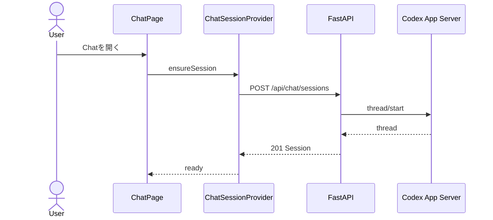
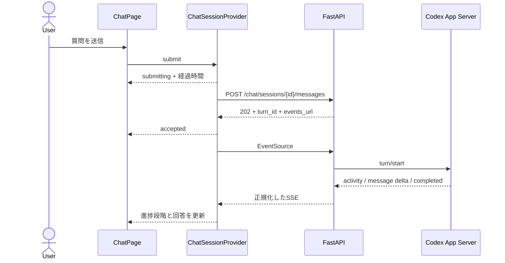

# RepoSpec Viewer Phase 0 Chat進捗・画面移動対応 詳細設計書

- 文書バージョン: v1.1
- 更新日: 2026-10-20
- ステータス: 詳細設計案・実装前
- 対象Phase: Phase 0「Codex接続と最小チャット」の品質改善

本文書は、[概要仕様](./README.md)、[フロントエンド仕様](./frontend-spec.md)、[バックエンド仕様](./backend-spec.md)で定めたPhase 0 Chatについて、進捗表示、画面移動後の状態維持、Session作成失敗時の扱いを具体化する。本文書と上位仕様が矛盾する場合は、Phase 0 Chatの範囲に限り本文書を優先する。

## 1. 背景と目的

現在のChat画面は、質問送信後に送信ボタンを中止ボタンへ切り替える。一方、回答が始まるまでの状態や経過時間を十分に表示していないため、処理が続いているかを利用者が判断しにくい。

また、ChatのSession ID、Turn ID、Message、SSE接続を`ChatPage`内で管理している。回答中にRepositories画面へ移動すると、`ChatPage`の破棄に伴ってブラウザ側の状態とSSE接続が失われる。Chat画面へ戻った際には新しいSessionの作成を試みるため、元のTurnの状態を確認できない。

Session作成に失敗した場合は、画面の再描画をきっかけに自動試行を繰り返す可能性もある。利用者には「セッションを準備しています」と表示され続け、失敗理由と再試行方法が伝わらない。

この改善では、次の状態を実現する。

- 質問受付から回答完了まで、現在の処理段階と経過時間を確認できる
- 回答中に別画面へ移動しても処理を継続し、Chatへ戻ったときに同じSessionとTurnを表示する
- Session作成に失敗した場合は自動試行を止め、理由と再試行操作を表示する
- Codex接続エラーとrequest timeoutを区別し、機密情報を残さずバックエンドログで追跡できる

## 2. 現在の設計からの変更点

| 項目 | 現在 | 改善後 |
|---|---|---|
| Chatの対象 | `TEST_CHAT_WORKSPACE` | 変更しない。Repository登録数に依存しない |
| Frontendの状態 | `ChatPage`内のlocal state | `ChatSessionProvider`が子Routeの移動中も保持する |
| 回答中の画面移動 | SSEを閉じ、Turn情報を失う | ProviderがSSEとTurn情報を維持する |
| Session作成失敗 | 再描画後に再試行する可能性がある | 自動試行は1回で止め、利用者の再試行を待つ |
| 進捗 | 中止ボタンと回答欄のプレースホルダー | 処理段階、経過時間、接続状態を専用領域に表示する |
| エラー表示 | 固定文言 | `Problem Details`のcodeに応じた説明と操作を表示する |
| 503のログ | HTTP access logが中心 | operation、code、trace ID、安全な失敗理由を記録する |

今回の改善では、Phase 0 Chatを登録済みRepositoryへ紐づけない。RepositoryまたはViewerを対象とする会話はPhase 3で別に実装する。

## 3. 対象と対象外

### 3.1 対象

- ChatのSession作成と明示的な再試行
- Repository画面とChat画面の間を移動した場合の状態維持
- 進捗段階、経過時間、遅延案内、接続状態の表示
- Session作成失敗とTurn失敗のエラー表示
- 失敗したSessionをバックエンドのメモリへ残さない処理
- Codex接続エラーとrequest timeoutの区別
- 503、504応答の安全な診断ログ
- Frontend、Backend、手動テスト

### 3.2 対象外

- ブラウザ再読み込み後のSession復帰
- `sessionStorage`または`localStorage`へのSession ID保存
- Session snapshot APIの拡張
- 新しく作成したSSE接続でのevent cursor指定
- SSE Eventの再送を前提とした累積回答への置き換え
- Chat Session、Turn、MessageのPostgreSQL保存
- ブラウザや端末をまたいだChatの共有
- 複数タブ間のSession同期
- 複数Conversationの一覧、選択、削除
- RepositoryまたはViewerを選択するPhase 3のConversation
- Codexの完了予定時刻の予測
- モデルの非公開の推論内容の表示
- Phase 2 Generation Jobの進捗設計変更

ブラウザ再読み込み後の復帰と、SSE Eventの取りこぼし対策はPhase 4で扱う。今回の実装は、同一SPA内で子Routeを移動する場合に限定する。

## 4. 前提条件

### 4.1 Repository登録との関係

Phase 0 Chatは`TEST_CHAT_WORKSPACE`を読み取り専用で調査する。`repositories`テーブルと管理Workspaceを参照しないため、登録済みRepositoryが0件でも利用できる。

画面には「設定されたテスト用Workspaceが対象であり、登録済みRepositoryを選択する画面ではない」ことを表示する。Repositoryが0件であることを理由に、Chat入力欄やSession作成を無効にしない。

### 4.2 Sessionの保持範囲

Session ID、Turn、Message、SSE接続は、認証済みLayoutの子Routeより外側に配置する`ChatSessionProvider`がメモリ上で保持する。Chat画面を一度も開いていない場合はSessionを作成しない。

ブラウザを再読み込みした場合はProviderの状態を破棄し、新しいSessionを作成する。Web StorageへSession IDやMessage本文を保存しない。

## 5. 状態設計

### 5.1 Session状態

FrontendはSessionの準備状態を次の値で管理する。

| 状態 | 意味 | 入力欄 |
|---|---|---|
| `uninitialized` | Chatをまだ開いていない | 非表示または無効 |
| `preparing` | 新しいSessionを作成中 | 無効 |
| `ready` | 質問を送信できる | Turnがなければ有効 |
| `failed` | Sessionの作成に失敗 | 無効、再試行を表示 |

`failed`から`preparing`へ移るのは、利用者が再試行を押した場合だけとする。画面の再描画、Health polling、Route移動を理由に自動で再試行しない。

### 5.2 Turn状態

| 状態 | 意味 | 主な表示 |
|---|---|---|
| `idle` | 実行中Turnなし | 入力可能 |
| `submitting` | Message送信HTTPの応答待ち | `質問を送信しています` |
| `queued` | `202 Accepted`受信後、`turn.started`待ち | `質問を受け付けました` |
| `running` | CodexがTurnを実行中 | 現在の進捗段階 |
| `reconnecting` | 実行中にSSEが一時切断 | `進捗表示へ再接続しています` |
| `completed` | Turn完了 | 回答を表示し、入力を再度有効化 |
| `failed` | Turn失敗 | 公開可能な理由と再送信を表示 |
| `cancelled` | 利用者またはシステムが中止 | 中止済みと表示し、入力を有効化 |

`submitting`ではTurn IDがまだないため、中止APIを呼ばない。`queued`、`running`、`reconnecting`ではTurn IDがあるため、中止ボタンを表示する。

### 5.3 進捗段階

進捗段階は、モデルの推論内容ではなく、アプリが確認できた事実から決める。

| 段階 | 表示文言 | 遷移契機 |
|---|---|---|
| `submitting` | 質問を送信しています | Message送信APIの応答待ち |
| `accepted` | 質問を受け付けました | Message送信APIが`202`を返した |
| `running` | Codexが処理しています | `turn.started`を受信した |
| `answering` | 回答を作成しています | 最初の`message.delta`を受信した |
| `reconnecting` | 進捗表示へ再接続しています | SSE接続が一時切断した |

画面は質問送信時からの経過時間を1秒単位で更新する。30秒を超えた場合は「通常より時間がかかっています。処理は継続中です。」と補足する。完了時刻はCodexの処理内容によって変わるため、予測値を表示しない。

## 6. 主要フロー

### 6.1 初回のChat表示



Session作成要求は1回だけ送る。失敗した場合は`failed`へ移り、自動で同じPOSTを繰り返さない。

### 6.2 質問送信と進捗表示



### 6.3 回答中の画面移動

`ChatSessionProvider`は認証済みLayoutの内側、子Routeの外側に配置する。ChatからRepositoriesへ移動してもProviderとEventSourceを破棄しない。

Chatへ戻った場合は、Providerが保持するSession、Turn、Messageをそのまま表示する。新しいSessionを作成せず、実行中Turnを重複送信しない。

### 6.4 Session作成失敗と再試行

Session作成に失敗した場合は、APIの`Problem Details`から公開可能な説明を表示する。入力欄を無効にし、再試行ボタンを表示する。

利用者が再試行ボタンを押した場合だけ、Session作成をもう一度実行する。再試行中はボタンを無効にし、連続操作による多重POSTを防ぐ。

## 7. APIとEvent設計

### 7.1 API契約

既存のPhase 0 Chat APIを維持し、Session snapshot APIは追加しない。

```http
POST /api/chat/sessions
GET  /api/chat/sessions/{session_id}
GET  /api/chat/sessions/{session_id}/messages
POST /api/chat/sessions/{session_id}/messages
GET  /api/turns/{turn_id}
GET  /api/turns/{turn_id}/events
POST /api/turns/{turn_id}/cancel
```

`POST /api/chat/sessions`の応答形式と、`message.delta`の差分形式は変更しない。既存の`Last-Event-ID`による同一`EventSource`の自動再接続も維持する。

### 7.2 進捗Event

Frontendは既存Eventを次のように表示へ変換する。

| Eventまたは状態 | 表示 |
|---|---|
| Message送信中 | `質問を送信しています` |
| Message送信APIの`202` | `質問を受け付けました` |
| `turn.started` | `Codexが処理しています` |
| 最初の`message.delta` | `回答を作成しています` |
| EventSourceの`error` | `進捗表示へ再接続しています` |

### 7.3 エラー応答

| HTTP | code | 画面の扱い |
|---:|---|---|
| `502` | `CODEX_TURN_FAILED` | Codex要求の失敗を表示し、明示的な再試行を待つ |
| `503` | `CODEX_UNAVAILABLE` | App Serverへ接続できないことを表示し、明示的な再試行を待つ |
| `504` | `CODEX_TIMEOUT` | Codex要求が時間内に応答しなかったことを表示し、明示的な再試行を待つ |
| 通信失敗 | `NETWORK_ERROR` | Backend接続を確認する案内と再試行を表示する |

Frontendは`Problem Details.detail`を基本文言として表示し、`code`に応じて操作を決める。原因をログと照合できるよう、`trace_id`を問い合わせ用IDとしてエラー領域へ表示する。APIが返した未知のHTMLは描画せず、文字列として表示する。

## 8. Frontend設計

### 8.1 責務

| 対象 | 責務 |
|---|---|
| `ChatSessionProvider` | Sessionの準備、Turn、Message、SSEを子Routeの移動中も管理 |
| `ChatPage` | Message一覧、入力欄、進捗、送信・中止・再試行操作を表示 |
| `chatReducer` | SessionとTurnの状態遷移、回答差分によるMessage更新 |

Providerは認証済みLayoutの内側、子Routeの外側へ配置する。Chatを一度も開いていない場合はSessionを作らず、`ChatPage`から`ensureSession()`が呼ばれた時点で初期化する。

進捗表示は`ChatPage`内の小さなコンポーネントとして実装してよい。独立ファイルへの分割は、実装時の可読性に応じて判断する。

### 8.2 Session初期化の多重実行防止

Sessionの初期化は、Providerが保持する状態と実行中Promiseで制御する。

- `preparing`中に`ensureSession()`が呼ばれた場合は、同じ処理の完了を待つ
- `ready`の場合はAPIを呼ばない
- `failed`の場合は自動で呼び直さない
- 再試行ボタンは処理中に無効化する
- React Strict ModeでEffectが再評価されても、同じPOSTを二重送信しない

ChatのSession作成は副作用を伴うため、TanStack QueryのMutation再試行を無効にする。

### 8.3 画面表示

実行中はMessage一覧の末尾だけでなく、入力欄の直上へ進捗領域を表示する。

```text
Codexが処理しています
経過時間 00:18
[中止]
```

30秒を超えた場合は、同じ領域へ遅延案内を追加する。入力欄は実行中に無効化するが、状態文言と中止ボタンは常に操作可能な位置に残す。

進捗領域は`role="status"`と`aria-live="polite"`を使う。経過時間の1秒ごとの更新はスクリーンリーダーへ毎回読み上げさせず、進捗段階が変わった場合だけ通知する。

### 8.4 画面移動と終了

子Routeの移動ではTurnを中止しない。Providerが残るため、SSEも維持する。

ブラウザタブを閉じた場合や再読み込みした場合も、自動で中止APIを送らない。`beforeunload`の通信は成功が保証されず、意図しない中止にもなるためである。画面を再表示した場合は新しいSessionを作成する。

## 9. Backend設計

### 9.1 Session作成の整合性

Chat Sessionは`thread/start`が成功してから公開する。`thread/start`より前に一時オブジェクトを作る場合でも、失敗時はSession辞書とThread対応表へ残さない。

処理順は次のとおりとする。

1. 未公開のSessionオブジェクトを作成する。
2. Codex App Serverへ`thread/start`を送る。
3. 成功したThread IDをSessionへ設定する。
4. Session辞書とThread対応表へ登録する。
5. `201 Created`を返す。

同じHTTP要求が失敗しても、到達できないSessionをメモリへ蓄積しない。

### 9.2 App Server切断

App Serverが切断された場合、実行中Turnを`failed`へ変更し、`turn.failed`をEventBufferへ保存する。SessionのCodex Thread IDは破棄するが、Providerが保持しているSessionとMessageは画面移動中も維持する。

App Server再接続後に利用者が同じ内容を再送信した場合は、新しい一時Threadを作成してからTurnを開始する。

### 9.3 診断ログ

Codex接続エラーまたはrequest timeoutをHTTPエラーへ変換する際は、次の項目をwarning levelで記録する。

- `operation`: `chat.session.create`などの固定値
- `problem_code`: `CODEX_UNAVAILABLE`または`CODEX_TIMEOUT`
- `trace_id`
- 失敗分類: unavailable、process exited、request timeout
- timeoutの場合はJSON-RPC method

request timeoutは接続断と区別し、`504 / CODEX_TIMEOUT / retryable: true`へ変換する。Codex App Serverのプロセス停止や接続不能は`503 / CODEX_UNAVAILABLE / retryable: true`とする。

ログへ次の情報を含めない。

- access token、refresh token、Authorization header
- Codex認証保存先
- User Message本文、Assistant Message本文
- `TEST_CHAT_WORKSPACE`の絶対パス
- Codex App Serverのstderr全文

API応答は一般化した日本語文言を使用し、内部例外の全文をブラウザへ返さない。

## 10. テスト設計

### 10.1 Frontend component test

- Chat初回表示でSession作成POSTが1回だけ送信される
- React Strict ModeでもSessionを二重作成しない
- Session作成が503の場合に自動再試行せず、説明と再試行ボタンを表示する
- 再試行ボタンを押した場合だけ2回目の要求を送る
- Repository画面へ移動して戻ってもSession IDとMessageを維持する
- 回答中の画面移動でEventSourceを閉じず、Chatへ戻ると進捗を表示する
- submitting、accepted、running、answering、reconnectingを表示する
- 30秒経過後に遅延案内を表示する
- 完了、失敗、中止後に入力欄を再度有効化する
- IME、通常Enter、Shift + Enter、送信ボタンの既存テストが継続して成功する

### 10.2 Backend unit / integration test

- `thread/start`失敗時にSession辞書とThread対応表へデータを残さない
- App Server切断時に実行中Turnを失敗へ変更する
- Codex接続失敗が`503 / CODEX_UNAVAILABLE / retryable: true`になる
- request timeoutが`504 / CODEX_TIMEOUT / retryable: true`になる
- 503と504のログにtrace IDと分類があり、Message本文と絶対パスがない
- 既存のSSE順序、中止、App Server再接続のテストが継続して成功する

### 10.3 手動テスト

- Repositoryが0件の状態でPhase 0 Chatを利用できる
- 質問受付直後から進捗段階と経過時間が表示される
- 回答中にRepositoriesへ移動し、Chatへ戻って同じTurnの進捗または結果を確認できる
- App Server接続失敗時に準備中表示が続かず、エラーと再試行を確認できる
- エラー中にSession作成POSTが繰り返されない
- App Server復旧後、再試行操作でChatを利用できる

## 11. 主な実装対象

```text
frontend/src/app/AppLayout.tsx
frontend/src/features/chat/ChatSessionProvider.tsx
frontend/src/features/chat/ChatPage.tsx
frontend/src/features/chat/chatReducer.ts
frontend/src/features/chat/*.test.tsx
frontend/src/lib/types.ts

backend/app/api/routes.py
backend/app/chat.py
backend/app/codex/client.py
backend/app/main.py
backend/tests/unit/
backend/tests/integration/
```

Database Migrationは追加しない。実装中に責務を保ったままファイルを分割することは許容する。

## 12. 完了条件

1. 登録済みRepositoryが0件でもPhase 0 Chatを利用できる。
2. 質問送信後、回答開始前から進捗段階と経過時間が表示される。
3. 回答中に別画面へ移動してもTurnが継続し、Chatへ戻ると同じ状態を確認できる。
4. Session作成に失敗した場合は自動試行を止め、理由と再試行操作を表示する。
5. 503と504をtrace IDで追跡でき、ログに機密情報、Message本文、Workspace絶対パスが含まれない。
6. 失敗したSession作成がBackendのメモリへ残らない。
7. IMEを含む既存のBackend、Frontendテストが継続して成功する。
8. ChromeとSafariの手動テストで、進捗、画面移動、エラー復帰を確認できる。
