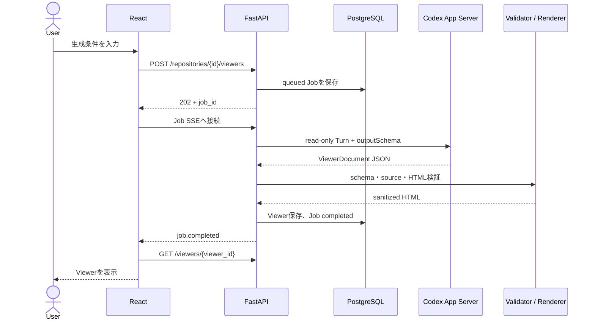
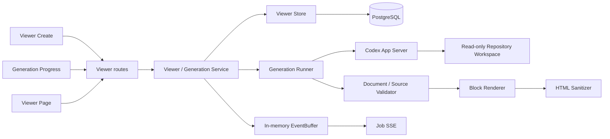
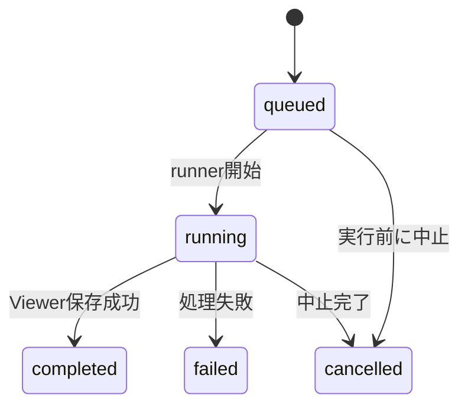

# RepoSpec Viewer Phase 2 詳細設計書

- 文書バージョン: v1.3
- 更新日: 2026-10-30
- ステータス: 安全設定の設計改訂・実装修正待ち・実Codex動作gate未完了
- 対象Phase: Phase 2「Viewer生成と保存」

本文書は、[概要仕様](./README.md)、[フロントエンド仕様](./frontend-spec.md)、[バックエンド仕様](./backend-spec.md)をPhase 2の実装へ落とし込む詳細設計書である。上位仕様と本文書が矛盾する場合は、Phase 2の範囲に限り本文書を優先する。

Phase 2では、Viewer全体を1つの固定テンプレートへ当てはめない。Codexが生成する構造化データと、アプリが管理する表示部品を組み合わせ、内容に応じて構成を変えられるViewerを実装する。

## 1. 目的とスコープ

### 1.1 目的

`ready`状態のRepositoryをCodexに読み取り専用で調査させ、根拠となるソース参照を含むViewerを生成・保存・閲覧できる状態にする。

Phase 2完了時には、次の操作がWeb画面から行える。

- 生成対象、文書種別、詳細度、対象読者、テーマ、表示密度、追加指示を指定する
- Generation Jobの進捗を確認し、必要に応じて中止または再試行する
- 生成済みViewerの一覧と本文を表示する
- Viewerを再生成する
- Codexを再実行せずにテーマと表示密度を変更する
- Viewerを削除する

### 1.2 対象

- Viewer作成フォームと選択肢API
- Generation Jobの作成、状態保存、SSE進捗配信、中止、再試行
- Codex App ServerによるRepository調査
- `ViewerDocument` JSON SchemaとPydantic検証
- Repository内ソース参照のCommit単位の検証
- 表示部品を組み合わせるHTML renderer
- サーバーとブラウザによる二段階のHTMLサニタイズ
- Viewer一覧、詳細、再生成、表示設定変更、削除
- Viewerと生成元Commitを保持するGit ref
- Backend、Frontend、renderer、セキュリティの自動テスト

### 1.3 対象外

- Viewer内Q&A、Conversation、Messageの永続化
- Source Code Viewerとソースコード取得API
- PDFまたは単体HTMLのエクスポート
- Viewer共有URL、アクセス権、マルチユーザー対応
- ユーザー定義テーマ、ユーザー入力CSS
- Codexが返したHTML、CSS、JavaScriptの直接表示
- Viewerの版管理、差分表示、過去版への復元
- 複数FastAPI worker、Redis、Celery、外部Job Queue
- Repositoryの変更、テスト実行、ネットワーク調査

Viewer内Q&AとSource Code ViewerはPhase 3で実装する。Phase 2のViewer画面には、後続機能を前提とした領域を常時表示しない。

### 1.4 現在の到達点（2026-10-30）

Phase 2の実装はPR #24でmainへマージ済みである。今回の変更対象は設計文書であり、以下の安全設定改訂をアプリへ実装する作業は次のPRへ分ける。

| 対象 | 実装済み | Fakeで検証済み | 実Codexで検証済み |
|---|---|---|---|
| Job、ViewerDocument、ソース参照検証、HTML生成・保存、画面 | Yes | Fake Codex + SQLiteで生成から保存まで成功 | 認証付き生成から保存までは未確認 |
| v1.2のPlugin列挙・Thread config・承認拒否 | Yes | 正常系・拒否経路を検証 | 設定API応答後、`plugin/list`でtimeout。動作gate未実行 |
| v1.3の起動overrideとThread runtime検査 | No（次回修正） | アプリとの結合testは未実施 | 非認証fixtureで起動・Thread・設定上書き・MCP canary未起動を限定確認（14.2） |
| read-only範囲、非変更、command network拒否、実生成 | 一部検査harnessあり。14.6へ改修が必要 | FakeはOS制限の証拠にしない | 未検証。`GENERATION_ENABLED=false`を維持 |

前回実装時の記録はBackend 52 tests、Frontend 23 tests、lint/build、SQLite migration成功である。今回の文書変更でこれらを再実行済みとは扱わない。実PostgreSQL適用、各画面幅の実browser目視も未完了であり、Phase 2全体を完了扱いしない。

## 2. 現在の設計からの変更点

既存の概要設計は、`ViewerDocument`を正本とし、検証済みデータからHTMLを生成する方針までを定めている。Phase 2では、未定義だった本文の組み立て方を次のように具体化する。

| 項目 | 概要設計で定義済みの内容 | Phase 2詳細設計 |
|---|---|---|
| 一貫性 | アプリ管理templateでHTMLを生成 | ページ全体を固定せず、表示部品の見た目と配置規則を共通化する |
| 本文構成 | `sections[].blocks[]`の概略のみ | 12種類のblockと、型ごとの入力項目・上限を定義する |
| セクション | 例として概要、フロー等を表示 | 内容に合わないセクションは省略し、順序も内容に応じて変える |
| Document Type | 生成条件として保持 | 必須テンプレートではなく、推奨する説明観点を示すprofileとして扱う |
| レイアウト | rendererがtemplateを適用 | Codexは意味構造を選び、rendererが幅・組み合わせ・レスポンシブ配置を決める |
| 図 | `flow`の概略のみ | nodeとedgeを構造化し、アプリが管理するHTML/CSSで描画する |
| Theme | 見た目を切り替える | 配色・書体の`Theme`と余白・文字量の`Density`を分離する |
| 画面モック | Viewer例を1種類掲載 | 特定の生成結果例として扱い、固定レイアウトの仕様にはしない |
| テスト | ViewerDocumentとXSSの単体検証 | blockの組み合わせ、上限値、レスポンシブ、Theme/Densityも検証する |
| Codexの読み取り範囲 | `sandboxPolicy.readOnly.access`で制限する想定 | Job固有Permission Profileを維持し、ThreadのProfile・runtime root・実動作を検証する |
| 外部tool | v1.2はPlugin一覧と`disabledPluginIds`へ依存 | 起動feature無効化、対象cwdの全設定、Threadのfeature/MCP状態を確認し、一覧取得を必須にしない |

次の方針は変更しない。

- `ViewerDocument`構造化JSONをViewer本文の正本とする
- AIが生成した任意HTML、CSS、JavaScriptを受け付けない
- Pydantic検証、ソース参照検証、renderer、sanitizerを通過したHTMLだけを保存する
- HTMLとTheme CSSを別に管理する
- `renderer_version`をViewerへ保存する
- ブラウザでもDOMPurifyを適用する
- Repository調査は読み取り専用とする

## 3. 設計原則

### 3.1 責務の分離

| 対象 | 責務 |
|---|---|
| Codex | 調査、説明内容、セクション順、意味に合うblock type、ソース参照を生成する |
| Pydantic validator | 型、必須項目、長さ、件数、ID参照、block固有条件を検証する |
| Source validator | path、Commit、blob、行範囲を実Repositoryに対して検証する |
| Renderer | blockを安全なHTMLへ変換し、表示幅と組み合わせを決める |
| Sanitizer | 生成後のHTMLから許可外のtag、属性、URLを除去する |
| Theme/Density | 保存済みHTMLを変更せず、CSS variablesとclassで見た目を変える |
| React | Viewer shell、操作、SSE、再サニタイズ、アプリ内イベントを管理する |

### 3.2 柔軟性の範囲

Codexはセクション数、順序、見出し、block type、block内容を選べる。一方、次の値は出力できない。

- 任意のHTML tagまたは属性
- CSS、class名、色、font、余白
- JavaScriptまたはevent handler
- x/y座標、幅、高さ、grid列数
- 外部画像、外部script、埋め込みcontent
- rendererが定義していないblock type

この境界により、内容に応じた構成変更と、Viewer間で共通する操作性・安全性を両立する。

## 4. ユースケース

### 4.1 Viewer新規作成



新規作成中はViewer行を作らない。Jobが完了したトランザクション内でViewerを作成し、`GenerationJob.viewer_id`へ設定する。失敗または中止したJobから、不完全なViewerは公開しない。

### 4.2 Viewer再生成

再生成は保存済みの生成条件を使い、Repositoryの最新Commitから同じViewerを更新する。

1. ユーザーがViewer画面で再生成を開始する。
2. APIは現在のViewerから生成条件を複製し、新しいJobを作成する。
3. 生成中も現在のViewerは閲覧できる。
4. Job成功時だけ、Viewer本文、生成元Commit、タイトル、summaryを1トランザクションで置き換える。
5. Job失敗または中止時は現在のViewerを変更しない。

生成条件を変えたい場合は新しいViewerを作成する。Phase 2の再生成画面では条件編集を行わない。

### 4.3 表示設定変更

ThemeとDensityの変更は`content_json`と`sanitized_html`を変更しない。APIはViewerの`theme_slug`と`density`だけを更新し、Codexとrendererを実行しない。

### 4.4 Viewer削除

Viewer削除は、対応するViewer用Git refを削除してからDB行を削除する。再生成Jobが実行中の場合は削除を拒否する。Repository、Workspace、GitHub上のデータは変更しない。

## 5. システム構成



### 5.1 Backendの配置

```text
backend/app/
  api/
    viewer_routes.py
    viewer_schemas.py
  generation/
    models.py
    service.py
    store.py
    runner.py
    prompt.py
    events.py
  viewers/
    document.py
    source_validation.py
    renderer.py
    sanitizer.py
    options.py
    git_refs.py
```

既存の`RepositoryOperationRunner`は、Clone、Sync、Generation、Repository削除で同じRepository単位Lockを使えるように拡張する。Generation専用の別Lockは作らない。

### 5.2 Frontendの配置

```text
frontend/src/features/
  generation/
    GenerationJobPage.tsx
    generationApi.ts
    generationEvents.ts
    generationTypes.ts
  viewers/
    ViewerCreatePage.tsx
    ViewerPage.tsx
    ViewerList.tsx
    ViewerDocument.tsx
    ViewerAppearanceDialog.tsx
    ViewerDeleteDialog.tsx
    viewerApi.ts
    viewerTypes.ts
    viewerSanitizer.ts
```

## 6. Viewer生成条件

### 6.1 選択肢

| 項目 | 値 | 初期値 | Codexへ渡す |
|---|---|---:|---:|
| Document Type | `functional_spec / technical_guide / process_flow` | `functional_spec` | Yes |
| Detail Level | `overview / standard / detailed` | `standard` | Yes |
| Target Audience | `engineer / beginner / product_manager` | `engineer` | Yes |
| Theme | `technical-light / editorial` | `technical-light` | No |
| Density | `comfortable / compact` | `comfortable` | No |

`Theme`は配色と書体を変える。`Density`は余白、文字サイズ、表のcell padding、block間隔を変える。どちらを変更しても説明内容と意味構造は変わらない。

### 6.2 入力値

| 項目 | 必須 | 制約 |
|---|---:|---|
| `request` | Yes | trim後1〜4,000文字 |
| `additional_instruction` | No | trim後0〜4,000文字。空文字は`null`へ正規化 |

追加指示は調査観点や説明方法の希望として扱う。権限変更、Repository更新、ネットワーク利用、任意HTML出力を求める内容が含まれても、システム側の制約を変更しない。

### 6.3 Document Type profile

Document Typeは固定された章構成ではない。Codexへ説明観点を伝えるprofileとして使用する。

| Type | 推奨する観点 |
|---|---|
| `functional_spec` | 目的、責務、入力・出力、処理、状態、例外、制約 |
| `technical_guide` | 背景、構成要素、実装の流れ、主要判断、拡張点、注意点 |
| `process_flow` | 開始条件、参加要素、手順、分岐、終了条件、失敗経路 |

Codexは、調査対象に存在しない観点を空のセクションとして出力しない。必要な観点は見出し名を変えてよく、順序も内容に合わせて変更できる。

promptでは各profileの観点を調査時の確認項目として扱う。Repository内の根拠を確認できた観点だけを本文へ含め、根拠がない観点を推測で補わない。User Requestが特定の観点を明示的に求めているにもかかわらず根拠を確認できない場合は、空のSectionを作らず`limitations`へ記録する。

profileは見出し名、Section数、順序を固定しないため、validatorでprofileごとの章構成は検証しない。promptに全観点と上記の選択規則が含まれることをUnit testで確認し、生成品質は文書種別ごとのfixtureと実Codexによる手動確認で評価する。

## 7. ViewerDocument

### 7.1 Top-level schema

```json
{
  "schema_version": "1.0",
  "title": "Repository登録・同期",
  "summary": "Public Repositoryを登録し、管理Workspaceへ同期する処理を説明します。",
  "sections": [],
  "source_references": [],
  "limitations": []
}
```

| Field | 型 | 制約 |
|---|---|---|
| `schema_version` | literal | `1.0` |
| `title` | string | 1〜200文字 |
| `summary` | string | 1〜1,000文字 |
| `sections` | array | 1〜20件 |
| `source_references` | array | 1〜100件 |
| `limitations` | string array | 0〜20件、各1〜1,000文字 |

JSON全体はUTF-8で1 MiB以下とする。全objectで`additionalProperties: false`を指定する。

JSON byte数は、Codexから受信した最終agent messageをUTF-8へencodeした値で判定し、JSON parseより先に確認する。fieldごとの上限を満たしていても、文書全体のbyte上限を超える場合は拒否する。

### 7.2 Section

```json
{
  "id": "processing-flow",
  "heading": "処理フロー",
  "summary": "登録から完了までの流れです。",
  "blocks": []
}
```

| Field | 型 | 制約 |
|---|---|---|
| `id` | string | 文書内で一意。`^[a-z][a-z0-9-]{0,63}$` |
| `heading` | string | 1〜120文字 |
| `summary` | string or null | 最大500文字 |
| `blocks` | array | 1〜30件 |

文書全体のblock数は100件以下とする。空のSectionは認めない。

Sectionごとの30件と文書全体の100件は両方を適用する。設定値でSection数、block数、JSON byte数を変更する場合、設定値は本文書に記載した上限以下でなければならない。上限を超える設定値は起動時validation errorとし、Pydantic modelの上限を暗黙に広げない。

### 7.3 共通Block field

全blockは次のfieldを持つ。

| Field | 型 | 制約 |
|---|---|---|
| `id` | string | 文書内で一意。`^[a-z][a-z0-9-]{0,63}$` |
| `type` | enum | 定義済みblock type |
| `title` | string or null | 最大120文字 |
| `source_reference_ids` | string array | 0〜20件、重複不可、存在する参照IDのみ |

事実を説明するblockには1件以上の`source_reference_ids`を設定する。調査上の制約や不明点だけを表す`callout`は空配列を許可する。

### 7.4 Block catalog

| Type | 用途 | 固有fieldと上限 |
|---|---|---|
| `paragraph` | 通常の説明 | `text`: 1〜6,000文字 |
| `bullet_list` | 並列する要点 | `items`: 1〜30件、各1〜1,000文字、`ordered`: boolean |
| `key_value` | 項目と値の対応 | `items`: 1〜30件、`key`最大120文字、`value`最大2,000文字 |
| `table` | 同じfieldを持つ複数行 | `columns`: 1〜12件、`rows`: 1〜100件、cell最大1,000文字 |
| `code` | 根拠となる短いcode例 | `language`最大40文字、`code`最大20,000文字かつ200行、`caption`最大500文字 |
| `callout` | 注意、制約、不明点 | `tone`: `info / warning / limitation`、`text`最大2,000文字 |
| `steps` | 順序のある処理 | `items`: 1〜30件、各`label`最大120文字、`description`最大2,000文字 |
| `flow` | 処理の流れ | node 2〜30件、edge 1〜60件 |
| `state_diagram` | 状態と遷移 | state 2〜30件、transition 1〜60件 |
| `comparison` | 観点ごとの比較 | series 2〜4件、row 1〜30件、cell最大1,000文字 |
| `component_map` | 構成要素と依存 | component 2〜30件、relation 0〜60件 |
| `source_evidence` | 根拠一覧 | `items`: 1〜20件。参照IDと説明最大500文字 |

Block固有fieldの形は次のとおりとする。全fieldを必須とし、値を省略できるfieldは`null`を許可する。

| Type | 固有fieldの形 |
|---|---|
| `paragraph` | `text: string` |
| `bullet_list` | `ordered: boolean`, `items: string[]` |
| `key_value` | `items: {key: string, value: string}[]` |
| `table` | `columns: {id: string, label: string}[]`, `rows: {cells: string[]}[]` |
| `code` | `language: string`, `code: string`, `caption: string or null` |
| `callout` | `tone: enum`, `text: string` |
| `steps` | `items: {id: string, label: string, description: string}[]` |
| `flow` | `nodes: FlowNode[]`, `edges: Edge[]` |
| `state_diagram` | `states: StateNode[]`, `transitions: Edge[]` |
| `comparison` | `series: {id: string, label: string}[]`, `rows: {aspect: string, values: string[]}[]` |
| `component_map` | `components: ComponentNode[]`, `relations: ComponentRelation[]` |
| `source_evidence` | `items: {source_reference_id: string, explanation: string}[]` |

`table.rows[].cells`の件数は`columns`と一致させる。`comparison.rows[].values`の件数は`series`と一致させる。`steps.items[].id`、column ID、series IDは各block内で一意とする。

block typeは次の優先順で選ぶ。内容を表現できるという理由だけで、汎用的な`paragraph`または`table`へ寄せない。

| 内容 | 選ぶblock | 使い分け |
|---|---|---|
| 連続した説明 | `paragraph` | 他の型に当てはまらない文章を扱う |
| 並列する要点、順位、チェック項目 | `bullet_list` | 実行順序や状態遷移には使わない。`ordered: true`は順位など、順番に意味があるが手順ではない列挙に限定する |
| 名前と値の組 | `key_value` | 1件ずつ独立した属性を示す。同じ列構造を持つ複数行は`table`を使う |
| 同じ列を持つ複数行 | `table` | 比較対象を横並びで対照すること自体が主目的なら`comparison`を使う |
| 実行順序を持つ操作 | `steps` | 各項目にlabelと説明が必要な手順を扱う。単なる番号付き列挙には使わない |
| 複数対象の対照 | `comparison` | 2〜4系列を同じ観点で比較する場合だけ使う |
| 処理、状態、構成要素の関係 | `flow`、`state_diagram`、`component_map` | 時系列の処理、状態遷移、静的な構成と依存を区別する |
| 根拠そのものの解説 | `source_evidence` | SourceReferenceの一覧を繰り返す目的では使わず、根拠と結論の対応を説明する場合だけ使う |

同じ情報を複数のblockへ重複させない。`source_evidence`内で使用するSourceReference IDは、block共通の`source_reference_ids`にも同じ集合を設定する。

### 7.5 Diagram nodeとedge

`flow`、`state_diagram`、`component_map`は座標を持たない。概略は次の形とする。

```json
{
  "id": "clone",
  "label": "Cloneを実行",
  "description": "staging directoryへ取得します。",
  "kind": "process"
}
```

```json
{
  "from": "validate-url",
  "to": "clone",
  "label": "検証成功"
}
```

node IDはblock内で一意とし、全edgeの`from`と`to`が存在するnodeを参照することを検証する。ここでいうnodeにはstateとcomponentも含む。自己参照edgeと完全に重複するedgeは拒否する。循環は`state_diagram`と`component_map`では許可し、`flow`では許可しない。

nodeとedgeの種類は次に限定する。

- `FlowNode.kind`: `start / process / decision / end`
- `StateNode.kind`: `initial / normal / success / failure`
- `ComponentNode.kind`: `frontend / backend / database / external / process / other`
- `ComponentRelation.kind`: `calls / reads / writes / depends_on / publishes / subscribes`

nodeの`id`は共通Block IDと同じ形式、`label`は1〜120文字、`description`は`string or null`で最大1,000文字とする。Edgeの`label`は`string or null`で最大1,000文字とする。`ComponentNode.group`は`string or null`で最大120文字、`ComponentRelation.label`は`string or null`で最大1,000文字とする。

`flow`は`start`を1件、`end`を1件以上必須とする。`start`の入次数と`end`の出次数は0とし、全nodeが`start`から到達でき、いずれかの`end`へ到達できなければならない。`decision`の出次数は2以上とし、分岐するedgeのlabelを必須とする。

`state_diagram`は`initial`を1件必須とし、全stateが`initial`から到達できなければならない。`component_map`は関係を持たないcomponentを許可する。

### 7.6 SourceReference

```json
{
  "id": "src-repository-service",
  "path": "backend/app/repositories/service.py",
  "start_line": 121,
  "end_line": 158,
  "description": "Repository登録とClone開始"
}
```

| Field | 型 | 制約 |
|---|---|---|
| `id` | string | 文書内で一意。blockと同じID形式 |
| `path` | string | Repository相対POSIX path、1〜500文字 |
| `start_line` | integer | 1以上 |
| `end_line` | integer | `start_line`以上 |
| `description` | string | 1〜500文字 |

同じpathと行範囲を持つ参照は1件へまとめる。blockから参照されないSourceReferenceは検証エラーとする。

### 7.7 検証順序

1. agent messageをUTF-8 JSONとしてparseする。
2. JSON byte数を確認する。
3. Pydanticのdiscriminated unionで型を検証する。
4. Section、block、node、SourceReferenceのID一意性を検証する。
5. block間参照、edge、table columnの整合性を検証する。
6. block数、文字数、行数、配列件数の上限を検証する。
7. SourceReferenceを生成元CommitのGit objectに対して検証する。
8. 検証済みmodelだけをrendererへ渡す。

Codex App Serverの`outputSchema`には、型、必須field、enum、`additionalProperties: false`を含むschemaを渡す。model側のStructured Outputsで扱えない可能性がある文字数、配列件数、正規表現、相互参照はPydanticとSource validatorで検証する。

Schema検証に失敗しても、Codex出力を緩い形へ自動変換しない。Phase 2では同じJob内の自動再生成を1回だけ許可し、検証エラーの項目名だけを修正指示として渡す。2回目も失敗した場合は`DOCUMENT_SCHEMA_INVALID`でJobを失敗させる。

## 8. HTML renderer

### 8.1 出力単位

rendererは完全なHTML documentではなく、Viewer本文用のHTML fragmentを生成する。ReactがViewer Header、操作、目次、将来のQ&A領域を管理する。

HTML fragmentはThemeとDensityに依存しない。同じ`content_json`と`renderer_version`からは、常に同じHTMLを生成する。

block templateにはJinja 3.1系を使い、HTML templateのautoescapeと`StrictUndefined`を有効にする。AI出力へ`safe` filterを適用しない。サーバー側sanitizerには`nh3`を使い、明示したtag、属性、URLだけを許可する。

### 8.2 Blockの配置規則

rendererはblock typeと内容量から表示幅を決める。Codexの出力には配置指定を含めない。文字数はtrim後のUnicode code point数で数え、titleを含める。配列を持つblockの合計文字数は、表示するlabel、key、value、description、explanation、cellを合計する。

| Block | compact判定 | compactでない場合 |
|---|---|---|
| `paragraph` | 合計600文字以下 | 全幅 |
| `bullet_list` | 6項目以下かつ合計600文字以下 | 全幅 |
| `steps` | 4項目以下かつ合計800文字以下 | 全幅 |
| `comparison` | 2系列、4行以下、合計800文字以下 | 全幅 |
| `key_value` | 6項目以下かつ合計800文字以下 | 全幅 |
| `callout` | 合計500文字以下 | 全幅 |
| `source_evidence` | 4項目以下かつ合計800文字以下 | 全幅 |
| `table`, `code`, `flow`, `state_diagram`, `component_map` | compactにしない | 常に全幅 |

同じSection内で隣接するcompact blockを先頭から2件ずつ組にし、Viewer本文containerが1,024px以上の場合に2列表示する。全幅blockを挟んで組にしない。連続するcompact blockが奇数件の場合、最後の1件は全幅にする。rendererは組を作るためにblock順を入れ替えない。

Viewer本文containerが1,024px未満の場合は、compact判定にかかわらず全blockを1列にする。判定にはviewportのmedia queryではなく、document containerへ設定したCSS Container Queryを使用する。tableとcodeはcontainer内で横scrollを許可する。

### 8.3 Diagramの描画

外部diagram libraryと実行時JavaScriptは使わない。

- `flow`はtopological sortで段階を算出し、同じ段階では入力JSONのnode順を維持して、処理cardと接続関係をHTML/CSSで表示する
- `state_diagram`は状態cardと遷移一覧を表示する
- `component_map`はcomponentのgroup別cardとrelation一覧を表示する
- 次のfallback条件を1つでも満たす場合は、card配置を使わず表形式へ切り替える
- 画面幅が狭い場合は縦方向へ並べる

| Diagram | 表形式へ切り替える条件 |
|---|---|
| 共通 | nodeが13件以上、edgeが19件以上、またはいずれかのnodeの入次数か出次数が4以上 |
| `flow` | topological sortで算出した段階が9段階以上 |
| `state_diagram` | 共通条件だけを使用する |
| `component_map` | groupが5件以上、または1つのgroupに9 component以上ある |

境界値はcard表示側へ含める。たとえばnode 12件、edge 18件、最大次数3は、ほかの条件を満たさない限りcard表示とする。表形式では次の列を固定し、接続関係を省略しない。

- `flow`: 接続元、接続先、edge label、接続先nodeのkindとdescription
- `state_diagram`: 遷移元、遷移先、transition label、遷移先stateのkindとdescription
- `component_map`: 接続元、接続先、relation kind、label、両componentのgroup

見た目よりも、node名、接続元、接続先、edge labelを読み取れることを優先する。

### 8.4 ThemeとDensity

ReactはViewer rootへ次のclassを設定する。

```text
viewer-theme-technical-light
viewer-theme-editorial
viewer-density-comfortable
viewer-density-compact
```

ThemeはCSS variablesの値だけを定義する。Densityはspacing、font-size、line-height、table paddingを定義する。block固有stylesheetは共通とし、ThemeごとにDOM構造を変えない。

### 8.5 renderer version

初期versionは`viewer-html-v1`とする。rendererのDOM構造、class契約、sanitizer allowlistを互換性なく変更するときはversionを上げる。

古いViewerをGETしただけでは自動再レンダリングしない。将来の移行処理は`content_json`から明示的に再生成し、成功後にHTMLとversionを同時更新する。

## 9. HTMLの安全性

### 9.1 サーバー側

rendererは値をすべてescapeしてからHTMLへ挿入する。MarkdownやAI出力内のHTMLを再解釈しない。

sanitizerのallowlistは次を上限とする。

```text
article, section, div, nav, aside,
h2, h3, h4, p, ul, ol, li,
dl, dt, dd, table, caption, thead, tbody, tr, th, td,
pre, code, strong, em, span, button, a
```

許可する属性は、rendererが生成する`class`、`id`、`role`、`aria-*`、`data-block-type`、`data-source-reference-id`、buttonの`type`、tableの`scope`、aの`href / target / rel`だけとする。

- `style`、`src`、`srcdoc`、`on*`を許可しない
- URLは文書内anchorか、対象Repositoryの`https://github.com/...`だけを許可する
- 外部linkには`target="_blank"`と`rel="noopener noreferrer"`をrendererが付ける
- sanitize前後の構造差分がallowlist除去以外を示す場合は保存しない

### 9.2 ブラウザ側

Reactは受信した`sanitized_html`へDOMPurifyを再適用し、Viewer専用containerへ`dangerouslySetInnerHTML`で挿入する。設定はサーバーallowlist以下に限定する。

source参照の操作はinline event handlerを使わない。containerのclick eventから`data-source-reference-id`を読み、APIから受け取った`content_json.source_references`と照合する。Phase 2ではpathと行範囲を表示し、Phase 3でSource Code Viewerを開く。

### 9.3 CSP

本番配信では少なくとも次を設定する。

```text
default-src 'self';
script-src 'self';
style-src 'self';
img-src 'self' data:;
connect-src 'self';
object-src 'none';
base-uri 'none';
frame-ancestors 'none';
form-action 'none'
```

開発時のVite接続先は環境別設定で追加し、本番CSPへ開発用originを含めない。

## 10. データベース設計

### 10.1 viewers

```sql
CREATE TABLE viewers (
    id UUID PRIMARY KEY,
    repository_id UUID NOT NULL REFERENCES repositories(id) ON DELETE RESTRICT,
    title VARCHAR(200) NOT NULL,
    summary VARCHAR(1000) NOT NULL,
    document_type VARCHAR(32) NOT NULL,
    detail_level VARCHAR(16) NOT NULL,
    target_audience VARCHAR(32) NOT NULL,
    theme_slug VARCHAR(32) NOT NULL,
    density VARCHAR(16) NOT NULL,
    content_json JSONB NOT NULL,
    sanitized_html TEXT NOT NULL,
    request TEXT NOT NULL,
    additional_instruction TEXT,
    commit_sha VARCHAR(64) NOT NULL,
    renderer_version VARCHAR(32) NOT NULL,
    content_revision INTEGER NOT NULL DEFAULT 1,
    created_at TIMESTAMPTZ NOT NULL,
    updated_at TIMESTAMPTZ NOT NULL
);
```

`status`は持たない。Viewer行が存在する状態を閲覧可能とみなし、生成途中・失敗・中止は`generation_jobs`で管理する。

`content_json`は正本、`sanitized_html`は導出データである。両方を同じトランザクションで保存する。

### 10.2 generation_jobs

```sql
CREATE TABLE generation_jobs (
    id UUID PRIMARY KEY,
    repository_id UUID NOT NULL REFERENCES repositories(id) ON DELETE RESTRICT,
    viewer_id UUID REFERENCES viewers(id) ON DELETE SET NULL,
    retry_of_job_id UUID REFERENCES generation_jobs(id) ON DELETE SET NULL,
    operation VARCHAR(16) NOT NULL,
    status VARCHAR(16) NOT NULL,
    current_phase VARCHAR(32) NOT NULL,
    request TEXT NOT NULL,
    additional_instruction TEXT,
    document_type VARCHAR(32) NOT NULL,
    detail_level VARCHAR(16) NOT NULL,
    target_audience VARCHAR(32) NOT NULL,
    theme_slug VARCHAR(32) NOT NULL,
    density VARCHAR(16) NOT NULL,
    base_viewer_revision INTEGER,
    commit_sha VARCHAR(64) NOT NULL,
    codex_thread_id VARCHAR(255),
    codex_turn_id VARCHAR(255),
    idempotency_key VARCHAR(128) NOT NULL,
    request_hash VARCHAR(64) NOT NULL,
    cancel_requested_at TIMESTAMPTZ,
    started_at TIMESTAMPTZ,
    completed_at TIMESTAMPTZ,
    error_code VARCHAR(64),
    error_message VARCHAR(500),
    error_retryable BOOLEAN,
    created_at TIMESTAMPTZ NOT NULL,
    updated_at TIMESTAMPTZ NOT NULL,
    CONSTRAINT uq_generation_job_idempotency
      UNIQUE (repository_id, idempotency_key)
);
```

`operation`はViewerへの作用を表す`create / regenerate`とする。再試行で作成したJobも元の`operation`を引き継ぎ、元Jobは`retry_of_job_id`で記録する。`status`は`queued / running / completed / failed / cancelled`、`current_phase`は11章で定義する値だけを許可する。

PostgreSQLでは、Repositoryごとにactive Jobを1件へ制限するpartial unique indexを作る。

```sql
CREATE UNIQUE INDEX uq_generation_jobs_active_repository
ON generation_jobs (repository_id)
WHERE status IN ('queued', 'running');
```

主なindexは次のとおりとする。

- `viewers(repository_id, updated_at DESC)`
- `generation_jobs(repository_id, created_at DESC)`
- `generation_jobs(status, updated_at)`
- `generation_jobs(viewer_id, created_at DESC)`

### 10.3 Theme catalog

Themeは編集対象のdomain dataではなく、フロントエンドstylesheetとrenderer契約に対応する組み込みcatalogとする。Phase 2では`themes`テーブルを作らない。

ThemeまたはDensityを追加するときは、Backendの選択肢、FrontendのCSS、表示確認testを同じ変更で追加する。

### 10.4 Jobの保持とRepository削除

Generation Jobは操作履歴として30日間保持する。Repository削除時は次の順序で処理する。

1. active Jobがあれば`REPOSITORY_BUSY`で拒否する。
2. Viewerがあれば`REPOSITORY_IN_USE`で拒否する。
3. terminal状態のGeneration Jobを削除する。
4. Phase 1で定義したWorkspaceとRepository行の削除を行う。

外部キーは`ON DELETE RESTRICT`のままとし、意図しない連鎖削除を行わない。

期限切れのterminal Jobは、アプリ起動時と24時間間隔のcleanup taskで削除する。`queued / running`は経過日数にかかわらず保持し、11.5の中断回復を先に行う。cleanup失敗はJob実行を停止させずwarning logへ記録し、次回実行で再試行する。

## 11. Generation Job

### 11.1 状態遷移



terminal状態から別状態へは遷移しない。中止と完了が競合した場合は、DBで先に確定したterminal状態を採用する。

状態更新は、更新前の`status`をWHERE条件に含めたcompare-and-setで行う。`queued -> running`はrunner開始時、`running -> completed`はViewer保存と同じDB transactionで確定する。`failed / cancelled`への更新も`status IN ('queued', 'running')`を条件とし、更新件数が0件の場合は、すでに確定したterminal状態を上書きしない。

### 11.2 Phase

| 順序 | `current_phase` | 処理 |
|---:|---|---|
| 0 | `queued` | runner開始待ち |
| 1 | `preparing_repository` | Repository、Commit、Workspace、Git refを確認 |
| 2 | `starting_thread` | Codex Threadを作成 |
| 3 | `analyzing_repository` | Codex Turnを実行しJSONを受信 |
| 4 | `validating_document` | JSONとSourceReferenceを検証 |
| 5 | `rendering_html` | block rendererでHTML fragmentを生成 |
| 6 | `sanitizing_html` | allowlist sanitizerを適用 |
| 7 | `saving_viewer` | ViewerとGit refを確定 |
| 8 | `completed` | 完了 |

`failed`と`cancelled`では、失敗または中止が確定した時点の`current_phase`を残す。

### 11.3 SSE event

| Event | Payload |
|---|---|
| `job.started` | `job_id`, `status` |
| `job.phase.changed` | `job_id`, `phase`, `completed_phases` |
| `job.sources.validated` | `job_id`, 検証済みRepository相対pathの配列 |
| `job.completed` | `job_id`, `viewer_id` |
| `job.failed` | `job_id`, 公開可能なerror |
| `job.cancelled` | `job_id` |
| `heartbeat` | 空object |

CodexのJSON delta、推論内容、command全文、絶対path、stderrはSSEへ流さない。pathはSourceReference検証後のRepository相対pathだけを`job.sources.validated`で通知する。

イベントは既存のbounded `EventBuffer`をJobごとに使う。SSE再接続では`Last-Event-ID`を受け付け、現在のbufferに残っているイベントだけを再送する。bufferの上限超過とプロセス再起動による欠落は復元しない。

FrontendはJobが`queued / running`の間、SSEと併用して`GET /api/generation-jobs/{job_id}`を5秒間隔で取得する。SSEを即時の進捗表示、REST応答を永続状態の正本として扱う。これにより、SSE接続が見かけ上は継続していてもbufferが失われた場合や、古い`Last-Event-ID`を再送できない場合に最長5秒で現在状態へ復帰する。terminal状態を取得した時点でpollingとSSEを停止する。

### 11.4 中止

- cancel APIはJob行をlockして状態を再確認する
- `queued`は`cancel_requested_at`を設定し、同じtransactionで`cancelled`へ更新する。commit後に登録済みrunner Taskをbest effortでcancelする。runnerがすでに起動していた場合も、`queued -> running`のcompare-and-setに失敗した時点で終了する
- `running`は`cancel_requested_at`を設定して`202 Accepted`を返す。同じJobへの再度のcancel requestは同じ状態を返し、処理を重複させない
- `starting_thread`以前はrunnerのTaskをcancelする
- `analyzing_repository`では`turn/interrupt`を送信する
- 検証以降は各phaseの境目で`cancel_requested_at`を確認する
- `saving_viewer`ではJob行をlockし、`cancel_requested_at IS NULL`かつ`status = running`の場合だけViewer保存へ進む。保存transactionが先にJob行をlockした場合は保存を完了し、cancel APIはcommit後の`completed`を返す
- terminal状態へのcancel requestは状態を変更せず、`200 OK`で現在のJobを返す
- ブラウザのSSE切断だけではJobを中止しない

### 11.5 プロセス再起動

起動時に残った`queued / running`は`failed / OPERATION_INTERRUPTED`へ更新する。Phase 2では自動再開しない。該当Job IDのGeneration refを削除し、未完了のin-memory event bufferを破棄して、利用者へ再試行を案内する。

起動時にはViewer revision refもDBと照合する。DBの`viewer_id / content_revision / commit_sha`に一致しないrefは孤立refとして削除する。削除に失敗しても参照可能なViewerのrefは変更せず、warning logへref名、Repository ID、trace IDを記録して次回起動時に再試行する。

## 12. API設計

APIのJSON keyは`snake_case`、日時はUTC ISO 8601、IDはUUID、Commit SHAは完全値とする。

### 12.1 Viewer選択肢

```http
GET /api/viewer-options
```

label、説明、既定値を含む組み込みcatalogを返す。フロントエンドは送信可能なenumを独自に増やさない。

### 12.2 Viewer一覧

```http
GET /api/repositories/{repository_id}/viewers
```

`updated_at`降順で返す。初期版はページングを設けない。各itemには`id`、`title`、`summary`、生成条件、Commit SHA、更新日時を含め、`content_json`と`sanitized_html`は含めない。

### 12.3 Viewer作成

```http
POST /api/repositories/{repository_id}/viewers
Idempotency-Key: <uuid>
Content-Type: application/json

{
  "request": "Repository登録から同期完了までを説明してください。",
  "document_type": "functional_spec",
  "detail_level": "standard",
  "target_audience": "engineer",
  "theme_slug": "technical-light",
  "density": "comfortable",
  "additional_instruction": null
}
```

- `ready`のRepositoryだけを受け付ける
- active Jobがある場合は`409 GENERATION_ALREADY_RUNNING`とする
- `202 Accepted`、`Location: /api/generation-jobs/{job_id}`、`Retry-After: 2`を返す
- responseは`job_id`、`status`、`events_url`、`viewer_id: null`を含む

### 12.4 Viewer詳細

```http
GET /api/viewers/{viewer_id}
```

Viewer metadata、`content_json`、`sanitized_html`、Repository表示情報を返す。ローカル絶対path、Codex Thread、Codex Turn、追加指示以外の内部promptは返さない。

### 12.5 Viewer再生成

```http
POST /api/viewers/{viewer_id}/regenerate
Idempotency-Key: <uuid>
```

Request bodyは受け取らない。保存済み条件とRepositoryの最新Commitを使用し、`202 Accepted`で新しいJobを返す。

### 12.6 表示設定

```http
PATCH /api/viewers/{viewer_id}/appearance
Content-Type: application/json

{
  "theme_slug": "editorial",
  "density": "compact"
}
```

少なくとも一方を必須とする。成功時は更新後のViewer metadataを返す。Codex実行、HTML再生成、`updated_at`以外の生成情報更新は行わない。

### 12.7 Viewer削除

```http
DELETE /api/viewers/{viewer_id}
```

- active再生成Jobがある場合は`409 VIEWER_BUSY`
- Viewer用Git refを削除してからDB行を削除する
- 成功時は`204 No Content`
- Git refが存在しない場合は続行できる
- Git ref削除に失敗した場合はDB行を残し`500 VIEWER_DELETE_FAILED`

### 12.8 Generation Job

```http
GET  /api/generation-jobs/{job_id}
GET  /api/generation-jobs/{job_id}/events
POST /api/generation-jobs/{job_id}/cancel
POST /api/generation-jobs/{job_id}/retry
```

`retry`は`cancelled`、または`error_retryable = true`の`failed` Jobだけを受け付ける。保存済みの生成条件とCommit SHAから、同じ`operation`を持つ新しいJobを作り、元Jobを`retry_of_job_id`へ保存する。新しい`Idempotency-Key`を必須とし、元のJobは変更しない。再生成の再試行では、元Jobの`base_viewer_revision`と現在のViewerが一致しない場合に`409 VIEWER_CHANGED`とする。

`cancel`は11.4の規則に従い、受理した場合は`202 Accepted`、すでにterminal状態の場合は`200 OK`で現在のJob表現を返す。Frontendはcancel APIの応答だけでterminal状態を確定せず、SSEまたはJob詳細APIで最終状態を取得する。

### 12.9 Idempotency

同じRepositoryと`Idempotency-Key`の組み合わせを再受信した場合、request hashが同じなら既存Jobを返す。payloadまたは操作対象が異なる場合は`409 IDEMPOTENCY_KEY_REUSED`とする。

idempotencyの照合はactive Jobの有無より先に行う。これにより、最初のrequestの応答を受け取れなかった再送は、active Jobが存在していても`GENERATION_ALREADY_RUNNING`ではなく同じJobを受け取れる。

request hashは、operation、Repository ID、対象Viewer IDまたは再試行元Job ID、正規化後のrequest bodyをkey順が一定のJSONへ変換し、SHA-256で算出する。作成時刻、trace ID、Idempotency-Key自体はhashへ含めない。再生成と再試行はRequest bodyが空でも操作対象をhashへ含める。

## 13. Generation処理

### 13.1 開始処理

1. 入力と選択肢、生成flag、接続、起動baselineを確認する。再送は12.9、実行前の安全確認は14.4に従う。
2. DB transactionでRepository行を`SELECT ... FOR UPDATE`し、`ready`であることを確認する。
3. 同じtransactionでactive Generation Jobがないことを確認する。
4. `latest_commit_sha`をJobへ複製し、`queued`のJobをcommitする。
5. commit後に既存のRepository単位runnerへTaskを登録する。
6. Task登録に失敗した場合は`failed / OPERATION_INTERRUPTED`へ更新する。

HTTP request内でCodex実行を待たない。DB commit前にTaskを開始しない。

Sync開始もRepository行を同じ方法でlockし、active Generation Jobがない場合だけ`syncing`へ更新する。開始APIは短いDB transactionをcommitしてからTaskを登録し、DB transactionを保持したままprocess内Lockを待たない。Clone、Sync、GenerationのTaskはprocess内Repository Lockを取得した後、短いDB transactionで予約済み状態を再確認してから外部処理を始める。

Repository削除は既存のprocess内Lockを取得した後、Repository行をlockしてactive JobとViewerの有無を確認する。削除以外の開始APIはprocess内Lockを直接取得しない。どの経路でも、DB transactionを保持したままCodexやGitを待たない。

`queued`のJobをcommitしてからTaskがRepository Lockを取得するまでの間も、Syncと削除はactive Jobを確認して拒否する。このため、Task開始前の時間差でSyncまたは削除が割り込まない。

### 13.2 Pipeline

1. Generation共有semaphoreで実行枠を取得する。
2. Jobが`queued`のままであることを確認し、Repository単位Lockを取得する。
3. Repository状態、Workspace、JobのCommit SHAを再確認し、`queued -> running`を確定する。
4. 一時Git refを作成し、CommitをGeneration中に保持する。
5. 対象cwdの有効設定を検査し、Threadを作成する。14.4のruntime検査合格後だけTurnを開始する。
6. 最終agent messageを蓄積する。
7. Turnの`completed`を確認する。
8. ViewerDocumentをparseし、構造とSourceReferenceを検証する。
9. 必要な場合だけschema修正Turnを1回実行する。
10. HTMLをrenderしてsanitizeする。
11. 新規Viewer IDまたは再生成対象Viewer IDを確定する。
12. 新しいViewer revision用Git refを作成する。
13. ViewerとJobを1つのDB transactionで保存する。
14. Generation用Git refと直前revisionのViewer refを削除する。
15. DB commit後に`job.completed`を通知し、Repository単位Lockと共有semaphoreを解放する。

Viewer revision refを作成できない場合は、Viewerを保存しない。DB transactionに失敗した場合は新しいrevision refを削除し、既存Viewerと既存revision refを変更しない。新しいrefの削除に失敗しても既存Viewerの整合性には影響しないため、孤立refとしてwarning logへ記録し、起動時の照合で再度削除する。

### 13.3 再生成の保存

再生成Jobは開始時の`content_revision`を`base_viewer_revision`へ保存する。Viewerを上書きするときは`viewer_id`と`content_revision`を条件へ含め、成功時にrevisionを1増やす。生成中にViewerが削除または別Jobで再生成されていた場合は`VIEWER_CHANGED`として失敗し、生成結果を適用しない。

再生成では`base_viewer_revision + 1`を新しいrevisionとし、その番号をViewer revision refへ使用する。DB commit後に旧revision refを削除する。旧ref削除に失敗しても新しいViewerは有効とし、孤立refのcleanup対象へ記録する。

ThemeとDensityの変更は`content_revision`を更新しない。このため、表示設定は再生成中でも変更できる。

### 13.4 失敗時

- 不完全な`content_json`とHTMLをDBへ保存しない
- Codexの生outputは通常ログへ出さない
- 一時Git refを片付ける
- 既存Viewerの内容を変更しない
- 公開可能な`error_code / error_message / retryable`をJobへ保存する
- terminal eventを発行する

## 14. Codex App Server連携

### 14.1 ThreadとTurn

採用方式は、既存のstdio App ServerとJob固有Permission Profileを維持し、**外部機能をプロセス起動時に無効化し、対象cwdの設定とThreadの実行状態を確認してからTurnを送る**方式とする。`plugin/list`と`disabledPluginIds`を安全性の根拠にするv1.2の設計を置き換える。別実行基盤、SDKへの移行、常設の別App Server、認証情報の複製は追加しない。

| 単位 | 責務 |
|---|---|
| Process | 固定CLIをstrict config・stdioで起動し、外部機能を無効化する。認証、request routing、承認拒否、接続世代の管理を担う |
| Thread | Jobごとにephemeralで新規作成する。Repositoryのreal path、一意Permission Profile、MCP無効化、アプリ管理の指示を固定し、応答とruntime inventoryを照合する |
| Turn | 検証済みThreadへ生成promptと`outputSchema`を渡す。修正Turnも同じ制限で最大1回とし、権限・cwd・tool構成を変更しない |
| Backend | Job・Repository排他、設定確認、追加権限拒否、ViewerDocument・SourceReference・HTML検証、保存可否を決める |

Phase 0の最小ChatとGenerationは既存の1プロセスを共有する。このため起動時の外部機能無効化はChatにも適用される。Chatの認証、read-only会話、SSE、中止を回帰確認する。Phase 0の旧sandbox指定はPhase 0 Threadだけの契約であり、Generation Thread/Turnへ流用しない。

Generation ThreadはPhase 3のQ&Aへ流用しない。

### 14.2 確認結果とCLI 0.164.0の契約

#### 14.2.1 既存環境の停止位置

確認対象の実行ファイルは、存在確認済みの`/Users/futaw/.local/bin/codex`、versionは`codex-cli 0.164.0`である。以前の実行ファイル不存在エラーとは分けて扱う。

利用者が実施した次の確認は、`config/read`、`configRequirements/read`の応答後、`plugin/list`の応答待ちで120秒のtimeoutとなった。

```bash
python -m backend.scripts.verify_generation_sandbox \
  --codex /Users/futaw/.local/bin/codex \
  --timeout 120
```

| 記録項目 | 結果 |
|---|---|
| OS | `macOS-26.6.2-arm64-arm-64bit` |
| `failed_check` | `plugin/list` |
| `failure` / detail | `CodexTimeoutError` / `Codex request timed out` |
| `protocol_config_gate` | `false`。設定確認が完了していない |
| `behavior_gate` | `false`。Thread/Turnへ到達せず、**未実行** |
| stable ThreadStartParams + TurnStartParamsのSHA-256 | `45308bd3a137736f46434eb9b402dfe9e2852114dae1168bd1412328645a6bda` |

この結果は権限制限の動作試験不合格を意味しない。また、2つの設定APIの応答取得は、Profile適用や全toolの無効化まで検証できたことを意味しない。

#### 14.2.2 ローカルCLIから確認した契約

2026-10-30に同じ実行ファイルで、次を専用の一時directoryへ生成して確認した。生成物はversion固有の契約として扱い、最新版ドキュメントだけでfieldの存在を判断しない。

```bash
/Users/futaw/.local/bin/codex --version
/Users/futaw/.local/bin/codex app-server --help
/Users/futaw/.local/bin/codex features list
/Users/futaw/.local/bin/codex app-server generate-json-schema --out <temporary-directory>/schema
/Users/futaw/.local/bin/codex app-server generate-ts --out <temporary-directory>/types
/Users/futaw/.local/bin/codex app-server generate-json-schema --experimental --out <temporary-directory>/schema-experimental
/Users/futaw/.local/bin/codex app-server generate-ts --experimental --out <temporary-directory>/types-experimental
```

| 根拠 | 確認できた事実と設計への反映 |
|---|---|
| `v2/PluginListParams` | `forceRefetch?: boolean`、`marketplaceKinds?: [...]`、`cwds?: absolute path[]`。`local`は有効なkindである。現在の`{"forceRefetch":false,"marketplaceKinds":["local"]}`は契約に合う。cwd省略時はhome側と公式curated marketplaceを考慮し、対象Repositoryの完全なinventoryではない |
| 同Paramsのコメント | `forceRefetch`はremote catalogの再取得要求を表す。`false`や`local`だけから、内部のremote処理や待ち時間が皆無とは判断できない |
| `v2/PluginListResponse` | `marketplaces`、`marketplaceLoadErrors`、`featuredPluginIds`。Plugin IDは`marketplaces[].plugins[].id`。旧形式の`data / plugins / pluginId`への互換fallbackは現versionの本番検証には使わない |
| `v2/ThreadStartResponse` | `disabledPluginIds`のコメントは`Saved list of disabled plugin IDs. Does not yet filter plugin capabilities.`。一覧を取得して全IDを渡すだけでは、機能無効化を保証できない |
| `v2/ConfigReadParams` | `cwd`で対象Repositoryのproject layerを解決できる。現在のcwd未指定の検査はJob用設定の確認として不足する |
| `v2/ConfigReadResponse` | `config / origins / layers`を返す。diskのlayerを解決した設定であり、`thread/start.config`の反映結果を読むAPIとして代用しない |
| `v2/ConfigRequirements` | `allowedApprovalPolicies`、`allowedPermissionProfiles`、`defaultPermissions`、`allowedWebSearchModes`、`featureRequirements`等が存在する。`repr()`の部分文字列検索ではなく、field単位で制約を評価する |
| experimental版`ThreadStartResponse` | `activePermissionProfile: {id, extends}`と`runtimeWorkspaceRoots`がある。`initialize.capabilities.experimentalApi=true`で応答を確認し、採用方式の実行前検査に使用する |
| `v2/ExperimentalFeatureListParams` | `threadId`付きでThreadの更新済み設定に基づくfeature状態を取得できる。`data / nextCursor`を最後まで取得する |
| `v2/ListMcpServerStatusParams` / `McpServerStatus` | `threadId`付きでThreadのMCP状態を確認できる。`runtimeStatus="disabled"`と空のtools/resources等を確認する。単なる未接続・空tool一覧では無効化の証明にならない |
| `SandboxPolicy.readOnly` | `access / includePlatformDefaults / readableRoots`は存在しない。Generationに旧SandboxPolicyを追加する変更はしない |
| CLI help / `features list` | `--strict-config`、`--disable <feature>`、`-c key=value`が存在する。14.3で列挙したfeature名は同versionに存在し、非機密fixtureでのstrict起動とThread状態を確認した |
| 起動設定の事前validation | 起動overrideとfixture Profileを`--print-startup-config`で受理した。ただし`--listen`との併用はCLIがexit 2で拒否するため、validation時はtransport引数を外す。出力はversionとrequirementsであり、全有効configのdumpではない |

stable schemaのhashは利用者の記録と一致した。experimental版の同じ2ファイルを同順で連結したSHA-256は`22f0824fd513113a775e75a87dbbb0126fd04e23469932b838754bc6f02f1bea`である。追加で使うResponse、feature、MCP関連schemaも次回harnessの記録対象にする。

[公式App Server資料](https://learn.chatgpt.com/docs/app-server)は`plugin/list`を開発中とし、本番clientからの使用を推奨していない。[設定の優先順位](https://learn.chatgpt.com/docs/config-file/config-basic#configuration-precedence)ではCLI overrideがproject・profile・user設定より優先される。一方、managed requirementsは設定とは別の制約である。`--profile`もbase user configへ重ねる仕組みであり、専用profile fileだけで設定・認証を隔離できるとは扱わない。

#### 14.2.3 今回の非機密fixtureによる限定確認

既存のRepository、`.env`、user config、認証情報を変更せず、一時`CODEX_HOME`とfixtureだけでJSONLの要求・応答を確認した。認証情報はコピーしておらず、モデルのTurnは実行していない。

| 試験 | 実Codexで確認した範囲 |
|---|---|
| 空の専用home、従来の`plugin/list`引数 | 正常応答、marketplace 0件。元の120秒timeoutはこの条件では再現しなかった |
| 起動時feature無効化、Job固有Profile | strict起動とThread作成に成功。`activePermissionProfile.id`一致、`extends=null`、runtime rootがfixture1件、`approvalPolicy=never`を確認 |
| trustedなfixtureのproject configでPlugin/App/browser/hooks/multi-agentを再有効化 | 起動overrideが優先され、14.3の全featureがThread上で`false`となった |
| 同fixtureにenabledなstandalone MCP canaryを追加し、Thread configでそのnameを無効化 | statusは`disabled`、tools/resources/resourceTemplatesは空。起動するとmarkerを作る非機密canaryは実行されなかった |
| fixtureに`AGENTS.md`を置き、`project_doc_max_bytes=0` | Threadの`instructionSources`は空だった |

以上は起動・設定・Thread確認の成立性を示す。実ユーザーの認証・全設定を引き継いだTurn、OSによる読み取り/変更/network拒否、`:minimal`の実際の読み取り範囲、Viewer保存までの成功は未検証である。Thread作成時にはprovider接続のDNS等のエラーも観測したが、元の`plugin/list`停止原因との因果関係は確認していない。

現時点で確定できるのは要求形式が有効であることまでである。CLI内部のlock、remote catalog、ローカルPlugin、認証・設定の組み合わせ、client readerの滞留などは切り分け候補であり、原因として断定しない。

### 14.3 起動設定と認証情報

既存の`CodexAppServer`を固定の引数配列で起動する。実行ファイルは`CODEX_EXECUTABLE=/Users/futaw/.local/bin/codex`とし、PATHやアプリ同梱CLIへfallbackしない。processのcwdはアプリが管理する固定directoryとし、Repositoryへ切り替えない。以下は次の実装修正で組み立てる起動契約であり、今回の文書更新ではアプリへ適用しない。

```text
/Users/futaw/.local/bin/codex app-server --strict-config --listen stdio://
  --disable plugins --disable remote_plugin --disable apps
  --disable browser_use --disable browser_use_external --disable browser_use_full_cdp_access
  --disable computer_use --disable in_app_browser
  --disable hooks --disable multi_agent --disable code_mode
  --disable image_generation --disable tool_suggest --disable skill_mcp_dependency_install
  --disable skill_search --disable workspace_dependencies
  --disable remote_control --disable memories --disable request_permissions_tool
  --disable shell_snapshot
  -c web_search="disabled"
  -c project_doc_max_bytes=0
  -c allow_login_shell=false
  -c shell_environment_policy.inherit="none"
  -c shell_environment_policy.ignore_default_excludes=false
  -c shell_environment_policy.set={PATH="/usr/bin:/bin:/usr/sbin:/sbin"}
```

上記は引数の一覧であり、そのまま複数行のshell commandとして実行する例ではない。TOML文字列の引用符を含め、各`key=value`を1引数として渡す。

Plugin本体とremote catalog、App、browser/computer、代替tool経路、hook・自動導入・shell snapshotを起動時に止める。commandのnetwork禁止はPermission Profileが担い、外部tool無効化とは別に検証する。モデルAPIへのApp Server自身の通信は必要であり、これをsandbox内commandの通信許可へ広げない。

認証は既存のApp Server管理を継続する。通常運用ではユーザーの`CODEX_HOME`とCodex管理のcredential storeを使い、バックエンドはtokenを取り出さず、別homeへのコピー、auth fileのsymlink、DBへの保存を行わない。専用homeは今回の非認証fixtureのためだけに使用した。設定APIから認証値をログへ出さず、未認証は既存の`AUTH_REQUIRED`経路へ返す。ログアウト・account変更時はGenerationの検査結果を失効させる。

`inherit=none`はCodexが起動するcommandの環境に適用し、App Server自身の認証処理とは分ける。下位layerの`set`やfilterはmergeされ得るため、指定したtableで全置換されたとは扱わない。各Jobで有効なshell環境設定を検査し、PATH以外の`set`、秘密値の注入、未評価のinclude/exclude・旧形式の組み合わせがあればfail closedとする。user設定を消して解決しない。必要なruntime追加は非機密の固定値だけをレビューし、動作gateを再実行する。[shell環境の公式契約](https://learn.chatgpt.com/docs/config-file/config-advanced#shell-environment-policy)も参照する。

### 14.4 Job開始前の確認と権限適用

#### 14.4.1 起動時

1. CLI version、通常版・experimental版schemaの必要field、起動引数を照合する。未知featureや非対応fieldがあればGenerationを無効とする。
2. 同じ設定overrideを`--strict-config --print-startup-config`へ渡し、config受理を確認する。CLI 0.164.0では`--listen`と併用できないため、このvalidationだけは`--listen stdio://`を外す。このcommandの成功だけでruntimeの安全性合格とはしない。
3. stdioで起動し、reader/stderr taskを開始して`initialize`（`experimentalApi=true`）/`initialized`を送る。Phase 0もこの接続を共用するが、実験fieldを無制限に公開しない。
4. `config/read {includeLayers:true}`、`configRequirements/read {}`、`account/read {refreshToken:false}`を順に取得する。固定feature、web search、shell環境、旧sandboxの有無とmanaged制約を確認する。
5. feature flagが`false`なら生成要求を受け付けない。`true`でも、このbaseline確認とJob固有の確認を省略しない。

`plugin/list`は起動とJob開始の必須要求から外す。取得不能を空一覧へ変換するのではなく、**全Plugin機能を無効化し、そのruntime状態を確認する別の安全条件**へ置き換える。列挙成功や`disabledPluginIds`の保存状態は合否に使わない。`config/value/write`、`config/batchWrite`、Plugin install/reconcileやMCP reloadは実行しない。

#### 14.4.2 Job開始時

1. 生成受付時は`GENERATION_ENABLED`、App Server接続、起動baselineの順に確認する。失敗は18章のProblem Detailsとし、Jobを新規作成しない。既存Jobの同一key再送は新たな実行とは分け、12.9の規則を維持する。
2. 既存のDB予約・semaphore・Repository Lockを取得後、Repository状態とCommitを再確認する。`WorkspaceResolver`がRepository IDから解決したreal pathだけを使う。
3. **毎Job**、`config/read {includeLayers:true,cwd:<repository-real-path>}`、`configRequirements/read {}`を順に取得する。process単位の`_security`をJob間・再接続後へ再利用しない。
4. 有効configと有効なlayerを検査する。14.3のfeatureと固定値、standalone MCPの全name、個別App設定、旧sandbox、profileの追加root/extends、shell環境、指示の注入元を確認する。欠落・型不正・未知の安全関連設定は失敗とする。非空の継承`instructions / developer_instructions`や追加の指示file等を無審査で受け入れない。
5. requirementsを同versionのschemaで評価する。`never`や`disabled`がallowlistから除外される、featureが`true`に固定される、Job固有Profileが許可されない、別defaultを強制される、評価できないmanaged制約がある場合は停止する。`requirements=null`は「managed制約なし」であり、API失敗やfield欠落とは区別する。
6. JobのUUIDから`repospec_generation_<hyphenなしUUID>`を作る。同名Profileが既存layerにあれば衝突として停止し、下位設定がmergeされないようにする。下記のThread configをアプリのallowlistから組み立てる。取得configをそのまま転送しない。
7. `thread/start`に`cwd`、`ephemeral=true`、`approvalPolicy=never`と下記config、アプリ管理の`developerInstructions`を送る。Generationでは`sandbox / sandboxPolicy / permissions`、追加workspace root、dynamicTools、selectedCapabilityRoots、外部environmentを指定しない。
8. Thread応答で`cwd`一致、`approvalPolicy=never`、`activePermissionProfile.id`一致・`extends=null`、`runtimeWorkspaceRoots`が対象real pathだけ、`instructionSources=[]`を必須とする。legacyな`sandbox.type=readOnly, networkAccess=false`だけで読み取りroot制限済みとは判断しない。
9. `experimentalFeature/list {threadId,...}`を全page取得し、14.3で無効化した全featureが存在して`enabled=false`であることを確認する。欠落、重複、不明な状態、timeoutは失敗とする。
10. `mcpServerStatus/list {threadId,...}`を全page取得する。各既知serverが`runtimeStatus=disabled`、`tools={}`、`resources=[]`、`resourceTemplates=[]`で、未知serverやPlugin由来serverがないことを確認する。0件は有効configにもserverがない場合だけ許可する。`failed / notStarted / null`を無効化成功に含めない。
11. 同じcwdで設定・requirementsを再取得し、安全関連値とlayer versionが検査開始時から変わっていないことを確認する。変更があればThreadを使用せず失敗とする。これらのAPIはThread configの読戻しではないため、送信config・Thread応答・runtime feature/MCPの照合も併せて必要である。
12. 全確認成功後だけ`turn/start`を送る。修正Turnの前にも接続世代、設定、feature/MCPを再確認する。別Job用Threadのresume/forkや権限overrideは行わない。

```json
{
  "default_permissions": "<job-profile>",
  "permissions": {
    "<job-profile>": {
      "description": "RepoSpec Viewer Generation read-only access",
      "filesystem": {
        ":root": "deny",
        ":minimal": "read",
        ":workspace_roots": {".": "read"}
      },
      "network": {"enabled": false}
    }
  },
  "web_search": "disabled",
  "project_doc_max_bytes": 0,
  "apps": {"_default": {"enabled": false}},
  "mcp_servers": {"<each-effective-server-name>": {"enabled": false}}
}
```

`<each-effective-server-name>`は説明用であり、実際には有効configにある全nameを列挙する。存在する個別Appの`enabled=false`も加える。MCPが0件の場合だけ空objectを使う。Appの個別設定が`_default`を上書きし得るため、globalな`features.apps=false`とThreadのfeature確認を必須とする。

`turn/start.params`は次に限定し、修正Turnでも同じ項目を送る。

| Field | 値 |
|---|---|
| `threadId` | runtime検査に合格した当該JobのThread ID |
| `input` | `[{"type":"text","text":"<生成または修正prompt>"}]` |
| `approvalPolicy` | `never` |
| `outputSchema` | 既存の`viewer_document_json_schema()`が返す完全なViewerDocument schema |

`disabledPluginIds`は送信しない。Turnからの`cwd / sandboxPolicy / permissions / model / environment`等のoverrideも許可しない。

旧`sandbox_mode / sandbox_workspace_write`が有効なlayerで非nullに明示設定されている場合はProfileと併用せず停止する。APIの固定fieldが`null`で返るだけの場合とは区別する。`:minimal`は同CLIのplatform/runtime集合であり、以前想定した`includePlatformDefaults`と同一とは保証しない。認証path・利用者document・兄弟Repositoryの読み取りを追加許可せず、実動作で制限を確認する。[Permission Profileの優先規則](https://learn.chatgpt.com/docs/permissions)では、より具体的なread/writeが広いdenyを上書きできるため、Profile名だけの一致確認では不十分である。

この方式が現CLIで成立する条件は、起動overrideの受理、必要なexperimental応答、Thread単位feature/MCP確認、JobのProfileとrootの一致、managed制約との両立、および14.6の動作gate合格である。いずれかを取得・検証できなければGenerationを開始しない。

### 14.5 診断ログ、timeout、接続断

通常ログはtrace ID、Job ID、接続世代、request ID、method、送信完了時刻、応答時刻・経過時間、結果分類を記録する。`CodexTimeoutError.method`を失わず、設定確認のどの段階が止まったか分かるようにする。加えてreaderの最終受信時刻、pending件数、通知handlerの開始/終了と処理時間、process exit code、EOF、不正JSON、遅延/未知response IDを記録する。stdout readerは応答を処理し続け、通知handlerから同じreaderの応答を同期的に待つ構造にしない。

configは安全関連のfield名と判定結果、layerの種別・version、Profile名、一致/不一致、件数だけを記録する。絶対pathは`repository / sibling / outside / codex_home`等の役割へ置換する。token、auth response、prompt、command本文、設定全文、Plugin/MCPのURL・header・env、stderr全文を出さない。stderrは許可したerror分類・targetと時刻に正規化し、正規表現によるtoken置換だけに依存しない。

`plugin/list`を追加調査するときは生成と切り離した診断モードで次の順に行う。診断の失敗・成功は採用方式のgateへ代入しない。

1. CLI version・schema hash・capability・引数名・cwd指定有無を固定し、既存記録の正確なpayloadと順序を確認する。現在のrunnerは3要求を`gather`、既存scriptは逐次送信であるため、混同しない。
2. 非認証の空home fixtureで同じ要求を送る。次にfixtureだけでlocal marketplace、project設定、起動featureを1要因ずつ変える。既存Pluginのinstall/uninstall・設定書換えは行わない。
3. `marketplaceKinds=["local"] / forceRefetch=false`を基準に、`cwds`省略とfixtureの絶対path指定、experimental capabilityの有無を比較する。remote再取得を伴う変更は別試験とし、timeout解消のために本番で有効化しない。
4. 生JSONLを読む最小clientとアプリclientを同条件で比較する。request ID付き送信が完了したか、stdoutに該当responseが届いたか、reader/handlerが滞留したかを記録する。必要なら未応答中の別のread要求の応答有無も確認する。
5. 空fixtureと既存認証環境には差があるため、fixtureで再現しなくても原因特定とはしない。実環境の安全な分類ログと照合し、CLI・設定・transportのどこまで到達したかを報告する。

request timeoutは既存の`CODEX_REQUEST_TIMEOUT_SECONDS`を使用する。scriptの`--timeout 120`は上限指定であり解決策ではない。設定確認中のtimeout・不正応答・安全設定不整合は`CODEX_SANDBOX_UNSUPPORTED`、接続前の停止・EOFは`CODEX_UNAVAILABLE`とし、Turnを送信しない。Thread作成中のtimeoutは作成有無が不明なため、新Threadを重ねて開始せず接続を破棄して再初期化する。

Turn中のJob timeoutは`turn/interrupt`を期限付きで送り、完了を確認できなければ共有processを終了して再起動する。共有processを終了した場合は同じ接続の他Job/Chatにも切断を通知する。接続断・拒否イベント・不整合を検知したJobは出力を保存せずterminal化し、修正Turnで迂回しない。再起動で接続世代を更新し、baselineとThread検査をやり直す。古い`_security`、Thread ID、遅延応答を再利用せず、Jobは自動再開しない。

正常終了またはTurn前の検査失敗で不要になったephemeral Threadには、同versionに存在する`thread/unsubscribe`を期限付きで送る。Thread作成・実行状態が不明な場合はunsubscribeだけで停止済みと判断せず、process終了で確定させる。

### 14.6 事前確認scriptと有効化条件

次の実装で`backend/scripts/verify_generation_sandbox.py`を修正する。現在のscriptの成功条件をそのまま流用しない。

| 段階 | 確認と合格条件 |
|---|---|
| Protocol/config gate | versionと必要schemaを検証し、14.3のstrict起動、対象cwdの設定・requirements、14.4のThread応答・全pageのfeature/MCP照合がすべて成功する。schemaのhashを計算しただけでは合格にしない |
| 決定的なsandbox probe | 同じcanonical Profileとcwdを`codex sandbox --permission-profile <fixture-profile> --include-managed-config -C <fixture>`で使用する。CLI helpに存在するこの経路とApp Server ThreadのProfile照合を併用し、モデルの試行省略を補う。既存Repositoryや設定へ書込みprobeを向けない |
| 実Turnの動作gate | 実App Serverでfixtureをcommandから読み、`outputSchema`付きのTurnを完了させる。実際のitemとprobe結果を確認し、モデルのboolean自己申告だけでは合格にしない。実行されないprobe、モデルの単なる拒否、provider障害は`inconclusive`である |
| 読み取り範囲 | 許可fixtureのランダムな非機密内容を読める。兄弟Repository、Workspace外、専用home内の認証path相当の非機密sentinelは読めない。親harnessから同じfileが読めることを対照確認する |
| 非変更 | 既存fileの更新・新規作成・削除・rename・`.git`更新を試し、OS拒否を確認する。成功時も例外時も`finally`で全fixture・sentinelの内容/存在/配置hashとGit statusを比較する。変更が1件でもあれば不合格 |
| command network | 正常に受け付ける一時loopback listenerと、harnessから疎通確認済みの非機密public endpointを使う。同じ接続がsandbox内で拒否されることを確認する。閉じた`127.0.0.1:9`、DNS失敗、単なる接続timeoutを拒否の証拠にしない。対照が失敗したら`inconclusive` |
| 外部tool | 全featureの無効状態、Thread MCP status、未起動canaryを照合する。非機密fixtureでPlugin/App/browser/MCP利用を誘導しても呼出しがなく、許可したcommand経路以外のtool itemが出ないことを確認する。知らないtoolが出れば不合格。回答の「使えない」だけでは合格にしない |
| 追加権限 | 実Threadの`never`と`request_permissions_tool=false`を確認し、追加権限を誘導してもProfile/root/networkが広がらず、権限toolを使えないことを実動作で確認する。server requestが来た場合はgatewayがschemaどおり拒否し、そのJobを失敗扱いにする |
| 防御用RPC拒否 | 実際のschemaに沿ったcommand/file/permissions要求の拒否応答と、拒否後にcompletedが届いても保存しないことをFakeで検証する。実Codexが要求を発しなければ`real_approval_request=not_observed`と記録する。安全性の合格根拠は実Threadでの要求経路無効化・非昇格とFakeでの拒否試験に分け、実RPCで拒否を観測済みとは記さない |
| 有効化後の完了確認（安全gateとは分離） | 非機密Repositoryで実ViewerDocument生成、SourceReference・renderer・sanitizer・DB/Git ref保存を確認する。違反・不整合・timeoutのJobはViewerを保存せず、再生成失敗時も元Viewerが残る。21.3の手順6で実施し、Phase 2完了条件に含める |

scriptは通常のpytestから分離し、プロセス起動と検査ロジックをアプリと共用する。通常実行から`plugin/list`を除き、必要なら明示的な診断オプションを追加する。機密情報を含まないfixtureだけを作成し、完了時に削除する。実認証の検査は既存credential storeを利用し、auth fileをfixtureへコピーしない。親harnessと内側sandboxを区別できる環境で実施し、外側のネットワーク遮断等をCodexの制限成功と誤認しない。

結果はgate別に`passed / failed / not_run / inconclusive`、`failed_check`、安全なreason、証拠種別（実CLI・実Turn・Fake）、CLI version、OS、schema hash、起動設定のversionを出す。従来booleanを互換維持する場合、`true`は`passed`だけとし、`false`の内訳を必須にする。protocol/configで停止した場合はbehaviorを`not_run`とする。観測keyの過不足と型を検証し、空objectへの`all()`や`all(observed.values())`による誤合格を防ぐ。全必須gateが`passed`の場合だけexit 0とする。

`GENERATION_ENABLED=true`にしてよいのは、次の実装修正と自動testが完了し、同じCLI・OS・安全設定で上記の必須安全gateがすべて合格し、21.3の手順1〜5を完了した場合だけである。その後、非機密Repositoryで手順6〜7の実生成・画面確認を行い、完了までPhase 2全体を完了扱いしない。`not_run / inconclusive`の安全gateを残して有効化しない。CLI・OS・安全設定・managed requirementsが変わった場合は再検証まで無効とする。有効化後も起動/毎Job/修正Turn前の検査を省略しない。今回の文書修正では**無効を継続**する。

### 14.7 Promptの構成

アプリ管理の`developerInstructions`に、read-only、command network禁止、外部tool禁止、追加権限禁止、Repository内の指示文を信頼されないデータとして扱うことを設定する。`project_doc_max_bytes=0`でRepositoryの`AGENTS.md`等を自動的な上位指示として読み込ませず、Threadの`instructionSources=[]`も検査する。ソース内やローカルskill内にある命令文を調査データから権限・動作指示へ昇格させない。

user inputのpromptは、確定済みCommit SHA、Document Type profile、Detail Level、Target Audience、User Request、Additional Instruction、根拠不足の扱い、SourceReferenceの相対pathと行範囲、空Sectionを作らない規則、ViewerDocument JSONだけを返す規則を区別して組み立てる。ThemeとDensityは含めない。自由入力でThread config、起動引数、tool設定を変更できない。promptの遵守だけをsandboxの代用にしない。

### 14.8 Notificationと保存判定

Generation serviceは接続世代・`codex_thread_id`・`codex_turn_id`で通知をJobへ対応づける。deltaは内部bufferにのみ蓄積し、推論本文・command全文・stderrを保存・配信しない。

予期しないcommand/file承認は`decision=decline`、permissions承認は空permissionsと`scope=turn`で拒否し、未知のserver requestは非対応errorで拒否する。拒否を受けたJobはinterruptして失敗化する。拒否後の`turn/completed.status=completed`を成功に戻さず、schema修正Turnも送らない。応答形式は利用CLIの生成schemaで確認する。

`turn/completed.status=completed`、安全設定検査合格、拒否/違反なしをすべて満たした出力だけを7章以降の検証へ渡す。`outputSchema`があってもPydantic、SourceReference、renderer、二段階sanitizerを省略しない。

## 15. SourceReferenceとGit ref

### 15.1 Commit単位の検証

SourceReferenceはworking treeの現在値ではなく、Jobへ保存したCommitに対して検証する。

1. pathをPOSIX pathとしてparseする。
2. 絶対path、空segment、`.`、`..`、backslash、NULを拒否する。
3. `git ls-tree -r -z <commit>`の結果にpathが存在することを確認する。
4. 通常blobであり、symlinkとsubmoduleでないことを確認する。
5. binary fileと上限を超えるblobを拒否する。
6. blobの実際の行数に対して`start_line / end_line`を確認する。

Gitは引数配列で起動し、pathやCommitをshell文字列へ連結しない。検証結果には絶対pathを含めない。

### 15.2 Git ref

Viewerが参照するCommitをGit GCから保護するため、管理用refを作る。

```text
refs/repospec/generation/<job-id>
refs/repospec/viewers/<viewer-id>/revisions/<content-revision>
```

- Job開始時にGeneration refを作る
- 新規作成ではrevision 1のViewer refを作り、DB commit後にGeneration refを削除する
- 再生成では新しいrevisionのViewer refを作り、DB commit後にGeneration refと旧revision refを削除する
- Viewer削除時に対象Viewer ID配下の全revision refを削除する
- failed、cancelled、起動時回復ではGeneration refを削除する
- DBに対応するViewer revisionがないrefは孤立refとし、起動時とViewer削除時に片付ける

ref名はアプリ採番UUIDとDBで確定した正の`content_revision`だけから作る。ユーザー入力を含めない。SourceReference取得時はDBの`commit_sha`と現在revisionのrefが同じCommitを指すことを確認する。

## 16. フロントエンド設計

### 16.1 Route

| Route | Page | 主な操作 |
|---|---|---|
| `/repositories/:repositoryId/viewers/new` | Viewer作成 | 条件入力、preview、生成開始 |
| `/jobs/:jobId` | Generation進捗 | phase表示、中止、再試行、Viewer遷移 |
| `/viewers/:viewerId` | Viewer閲覧 | 目次、本文、表示設定、再生成、削除 |

既存のRepository DashboardではViewer一覧をAPIから取得し、`ready`のときだけ作成ボタンを有効にする。

### 16.2 Viewer作成フォーム

表示順は次のとおりとする。

1. Request
2. Document Type、Detail Level、Target Audience
3. Theme、Densityとpreview
4. Additional Instruction
5. 生成開始、戻る

React Hook FormとZodを導入し、client validationを行う。正式な判定はAPI応答に従う。送信中は全項目と送信ボタンを無効化し、同じ`Idempotency-Key`で二重送信を吸収する。

previewは組み込みの固定sampleを使い、Codexを実行しない。ThemeとDensityの見た目だけを示し、生成される章構成を保証する表示にはしない。

生成開始失敗時は入力・選択肢を保持し、既存の`ApiError.problem`から`code / detail / trace_id`を表示する。「Viewer生成を開始できませんでした。」だけで終えない。

| code | 最小表示 | 操作 |
|---|---|---|
| `GENERATION_DISABLED` | 「Viewer生成は現在無効です。安全性の事前確認が完了していません。」 | 自動再試行しない。管理者の有効化待ち |
| `CODEX_UNAVAILABLE` | 「Codexに接続できません。接続状態を確認してから再試行してください。」 | 入力を保ち、明示的な再試行 |
| `CODEX_SANDBOX_UNSUPPORTED` | 「Codexの安全設定を確認できないため、生成を開始しませんでした。」 | 自動再試行しない。設定確認が必要であることを案内 |
| `NETWORK_ERROR`等 | Backendとの通信失敗または安全な一般エラー | 入力を保ち、接続確認と明示的な再試行 |

同じ分類を再生成・Job再試行にも使う。trace IDはBackendログとの照合用に表示し、生RPC、絶対path、Plugin名や内部設定は表示しない。受付後にJob固有の確認が失敗した場合は進捗画面へ同じcodeを表示し、`error_retryable=false`なら再試行ボタンを出さない。新しいHealth APIや状態配信基盤は追加せず、最終的な受付可否はPOSTの応答を正本とする。

### 16.3 Generation進捗

- Job全体の状態と現在phaseを文字で表示する
- 完了済みphaseと待機中phaseを区別する
- 検証後に安全なRepository相対pathだけを表示する
- 経過時間はclientで算出し、進捗率の推測には使わない
- SSE切断中は再接続表示を出し、RESTで状態を再取得する
- `queued / running`の間はSSE接続中も5秒間隔でJob詳細を取得し、SSE eventの取りこぼしとBackend再起動を補完する
- `completed`でViewerを自動表示し、手動の「Viewerを開く」も残す
- `cancelled`、または`failed`で`error_retryable=true`の場合は保存済み条件から再試行できる

### 16.4 Viewer画面

Viewer Headerにはタイトル、Repository、Branch、Commit SHA、Document Type、Detail Level、Target Audience、Theme、Density、更新日時を表示する。

本文は次のshellで表示する。

```text
+-------------------------------------------------------------+
| Viewer Header / Actions                                     |
+------------------+------------------------------------------+
| Table of contents| Sanitized Viewer Document                |
|                  | Sections and typed blocks                |
+------------------+------------------------------------------+
```

目次はSectionからReactが生成する。文書内blockの種類や順序はViewerごとに変わる。完成時の画面モックにあるフロー中心の本文は表示例であり、全Viewer共通の固定構成ではない。

Phase 2ではQ&A paneを表示しない。Phase 3でDesktopの右paneまたはMobileのDrawerを追加できるよう、Viewer shellとdocument containerを分離する。document containerへ`container-type: inline-size`を設定し、Q&A paneの追加で本文幅が狭くなった場合もrendererのHTMLを変更せず1列表示へ切り替える。

主要操作は次のとおりとする。

- 表示設定
- 再生成
- 削除
- GitHubの生成元Commitを開く
- Repository Dashboardへ戻る

### 16.5 Responsiveとアクセシビリティ

- Viewer本文containerが1,024px未満の場合にblockを1列にする
- 768px未満で目次を折りたたみ式にする
- 320px幅で横scrollが必要なのはtableとcodeだけに限定する
- 見出しlevelを飛ばさない
- 目次、dialog、buttonはキーボード操作できる
- Job更新は`aria-live="polite"`とし、heartbeatは読み上げない
- diagramは色だけに依存せず、node名と接続関係をtextでも示す
- ThemeとDensityの組み合わせごとにcontrastとfocus表示を確認する

### 16.6 Query key

| 用途 | Query key / mutation |
|---|---|
| 選択肢 | `['viewer-options']` |
| RepositoryのViewer一覧 | `['repositories', repositoryId, 'viewers']` |
| Viewer詳細 | `['viewers', viewerId]` |
| Job詳細 | `['generation-jobs', jobId]` |
| 作成 | `createViewer` mutation |
| 再生成 | `regenerateViewer` mutation |
| 表示設定 | `updateViewerAppearance` mutation |
| 削除 | `deleteViewer` mutation |
| Job中止・再試行 | `cancelGenerationJob / retryGenerationJob` mutation |

SSE中のphaseはPageのlocal stateへ反映し、terminal event受信後にJob queryを再取得する。Viewerの正式データは常にREST応答で更新する。

## 17. 並行制御

- 同じRepositoryではClone、Sync、Generation、Repository削除を同時実行しない
- 1つのRepositoryにつきactive Generation Jobは1件だけとする
- Viewer再生成中も表示設定変更は許可する
- Viewer再生成中のViewer削除は拒否する
- 異なるRepositoryのGenerationは並行実行できる
- 1つのApp Server processへ同時に送るGeneration Turn数は設定値で制限する
- Phase 2はFastAPI 1 workerに固定する

DBのpartial unique index、Repository行lock、Repository状態、active Job確認、process内Lockを併用する。process内Lockだけを正当性の根拠にしない。

開始判定は次の順序へ統一する。

| 操作 | DBでの予約 | Task実行時 |
|---|---|---|
| Clone / Sync | Repository行をlockし、許可された状態から`cloning / syncing`へ更新 | process内Repository Lock取得後に予約済み状態を再確認 |
| Generation | Repository行をlockし、`ready`とactive Jobなしを確認して`queued` Jobを作成 | process内Repository Lock取得後に`queued -> running`を確定 |
| Repository削除 | process内Repository Lock取得後にRepository行をlockし、処理中状態、active Job、Viewerなしを確認 | 同じHTTP request内で削除完了までLockを保持 |

Generation Jobが`queued`の間もactiveとして扱う。Syncはactive Jobが存在すれば`REPOSITORY_BUSY`、GenerationはRepositoryが`ready`でなければ`REPOSITORY_BUSY`を返す。Generation Taskは共有semaphoreで実行枠を取得してからprocess内Repository Lockを取得する。semaphore待機中もJobは`queued`のままとし、`running`と`started_at`は両方を取得した後に確定する。待機中にcancelledとなったJobはRepository Lockを取得せず終了する。

## 18. エラー契約

### 18.1 HTTP error

| HTTP | code | 場面 | retryable |
|---:|---|---|---:|
| 404 | `VIEWER_NOT_FOUND` | Viewerなし | No |
| 404 | `GENERATION_JOB_NOT_FOUND` | Jobなし | No |
| 409 | `GENERATION_ALREADY_RUNNING` | Repositoryにactive Jobあり | Yes |
| 409 | `VIEWER_BUSY` | 再生成中のViewer削除 | Yes |
| 409 | `VIEWER_CHANGED` | 再生成中にViewerが更新された | Yes |
| 409 | `IDEMPOTENCY_KEY_REUSED` | 同じkeyを異なるrequestで再利用 | No |
| 422 | `INVALID_VIEWER_OPTION` | 未知の選択肢 | No |
| 500 | `VIEWER_DELETE_FAILED` | Git refまたはDB削除失敗 | Yes |
| 503 | `CODEX_UNAVAILABLE` | App Server未接続 | Yes |
| 503 | `GENERATION_DISABLED` | 生成flagがfalse（gate未完了を含む） | No |
| 503 | `CODEX_SANDBOX_UNSUPPORTED` | 起動baselineの安全設定確認失敗。Job受付前に拒否 | No |

### 18.2 非同期Job error

| code | 場面 | retryable |
|---|---|---:|
| `OPERATION_INTERRUPTED` | process再起動 | Yes |
| `CODEX_SANDBOX_UNSUPPORTED` | 制限付きread-onlyを利用できない | No |
| `CODEX_TURN_FAILED` | Turn失敗 | Yes |
| `CODEX_TIMEOUT` | Generation timeout | Yes |
| `CODEX_USAGE_LIMIT` | 利用上限 | Yes |
| `DOCUMENT_SCHEMA_INVALID` | JSON schema不一致 | Yes |
| `SOURCE_REFERENCE_INVALID` | path、Commit、行範囲不正 | Yes |
| `HTML_RENDER_FAILED` | renderer失敗 | Yes |
| `HTML_SANITIZE_FAILED` | sanitizer検証失敗 | No |
| `GENERATION_FAILED` | 分類できない生成失敗 | Yes |

利用者向けerrorには、Codexの生output、prompt全文、絶対path、stack trace、Git stderrを含めない。

受付前はflag無効、接続不可、接続できるが安全設定未確認の順に分類する。設定確認APIのtimeoutは安全性確認失敗であり、一覧の空扱いや無条件の`CODEX_TIMEOUT`再試行へ変換しない。Job作成後の同種失敗は非同期errorへ記録する。表示は16.2、診断ログは14.5に従う。

## 19. 設定

| 環境変数 | 初期値 | 用途 |
|---|---:|---|
| `GENERATION_ENABLED` | `false` | 14.6の全gate合格後にだけ`true`とするGeneration機能flag |
| `GENERATION_TIMEOUT_SECONDS` | `900` | 1 Jobの上限時間 |
| `GENERATION_MAX_CONCURRENCY` | `2` | 異なるRepository間の同時生成数 |
| `GENERATION_EVENT_BUFFER_SIZE` | `200` | JobごとのSSE event保持数 |
| `VIEWER_DOCUMENT_MAX_BYTES` | `1048576` | JSON上限1 MiB |
| `VIEWER_MAX_SECTIONS` | `20` | Section上限 |
| `VIEWER_MAX_BLOCKS` | `100` | 文書全体のblock上限 |
| `VIEWER_SOURCE_MAX_FILE_BYTES` | `2097152` | 参照元blobの検証上限2 MiB |
| `GENERATION_JOB_RETENTION_DAYS` | `30` | terminal Job保持日数 |
| `VIEWER_RENDERER_VERSION` | `viewer-html-v1` | renderer契約version |

数値は正の値だけを受け付ける。`VIEWER_DOCUMENT_MAX_BYTES`は1 MiB、`VIEWER_MAX_SECTIONS`は20、`VIEWER_MAX_BLOCKS`は100をhard limitとし、環境変数では同じ値以下への引き下げだけを許可する。hard limitを超える設定値は起動時validation errorとする。

## 20. テスト設計

### 20.1 Backend Unit

- 全block typeの正常系と必須field不足
- 未知のblock typeと追加fieldの拒否
- Section、block、node、SourceReference IDの重複
- 壊れたedge、table column、source参照ID
- flowのstart/end、到達不能node、decision分岐、state_diagramのinitialと到達可能性
- 文書全体とblockごとの件数・文字数・行数上限
- path traversal、絶対path、backslash、symlink、submodule、binary blobの拒否
- Commitに存在しないpathと範囲外行番号の拒否
- HTML escape、allowlist、URL scheme、event属性、XSS payload
- rendererのcompact閾値、隣接blockの2列化、奇数件、全幅blockによる分断、container幅による1列化
- diagramの循環判定と、node、edge、次数、段階、group境界でのtable fallback
- Theme/Density変更でHTMLとcontentが変わらないこと
- Job状態遷移のcompare-and-set、中止と保存の競合、terminal状態の再更新拒否
- Idempotency-Keyとrequest hash
- revision付きGit ref名と作成・削除、孤立refの照合
- Generation Permission Profileの生成、Jobごとの一意なProfile名、pathの非連結
- 旧sandbox設定、不明なconfig、無効化できない外部toolのfail-closed判定

### 20.2 Backend Integration

- Alembic migrationとViewer/Job CRUD
- Repositoryごとのactive Job一意制約
- fake app-serverの`outputSchema`付きTurn完了
- fake app-serverでの起動override、対象cwd付き設定取得、Thread config・Profile/root・feature/MCP全page照合、追加権限要求拒否
- 設定変更、Thread応答欠落、Plugin inventoryに頼らないfail closed、再接続後の検査失効
- request timeoutとJob timeoutの分類、interrupt失敗時のprocess終了、古い応答の無視
- JSON delta蓄積、schema修正1回、2回目失敗
- Generation成功時のViewer、Job、Git ref確定
- Codex失敗、timeout、切断、中止、process再起動回復
- 再生成失敗時に既存Viewerを保持すること
- queued JobのTask開始前を含むSync、Repository削除、Generationの排他
- Viewer削除後のRepository削除
- SSE順序、重複排除、再接続、REST fallback
- API status、Problem Details、機密情報の非公開

自動テストは外部GitHubと実Codexの可用性へ依存させない。SourceReference検証はローカルのテスト用Git Repositoryを使う。

実Codexの動作gateは通常の自動テストから分離し、明示的な実行コマンドでだけ起動する。外部GitHubは使わず、一時directoryのfixtureとsentinelだけを使う。実行後はhashとGit statusで非変更を検証し、fixtureを削除する。

### 20.3 Frontend Unit / Component

- formの既定値、全選択肢、文字数validation
- Theme/Density previewと送信値
- 二重送信防止とIdempotency-Key維持
- Job phase、SSE再接続、5秒REST polling、terminal状態、再試行
- Viewer一覧の0件・複数件表示
- 12種類のblockを含むHTML表示
- DOMPurifyによる危険tag・属性の除去
- source参照clickと存在しないIDの無視
- 表示設定、再生成、削除dialog
- API失敗後の画面維持と再試行
- `GENERATION_DISABLED / CODEX_UNAVAILABLE / CODEX_SANDBOX_UNSUPPORTED`の表示、trace ID、入力保持、POST自動再試行抑止

### 20.4 E2Eと視覚確認

1. `ready`のRepositoryからViewerを生成し、進捗画面からViewerへ移動できる。
2. paragraph中心、table中心、diagram中心の3文書で構成が変わる。
3. Theme 2種類とDensity 2種類の全4組み合わせを切り替えられる。
4. 320px、768px、1,024px、1,440pxで本文を閲覧できる。
5. 1,440pxのviewportでQ&A相当の右paneを置き、本文containerを1,024px未満にした場合は全blockが1列になる。
6. tableとcode以外で意図しない横scrollが発生しない。
7. 再生成失敗後も元のViewerを閲覧できる。
8. Viewer削除後にRepository Dashboardへ戻り、件数が更新される。
9. XSS fixtureを含む生成結果を表示してもscriptが実行されない。

視覚testは単一のgolden Viewerだけに依存しない。block単体、複数blockの組み合わせ、長文、空に近い文書を含める。

## 21. 次の実装修正と手動確認

### 21.1 変更対象

PR #24の生成・検証・保存パイプラインを維持し、次の安全設定と表示の修正を1つの後続作業として行う。今回はこの表のアプリ変更を実施しない。

| ファイル | 現実装で今回の問題に関係する点 | 次回の変更 |
|---|---|---|
| `backend/app/generation/security.py` | `plugin_ids`が一覧の完全取得へ依存。旧形式fallbackあり。requirementsを`repr()`で判定する | Plugin列挙を安全条件から除去し、起動policy、cwd別config/requirements、Profile衝突、Thread応答、runtime feature/MCPのtyped検査へ変更。既知MCP/Appの無効化とallowlistによるconfig構築を維持 |
| `backend/app/generation/runner.py` | 3要求を`gather`し、成功結果を`_security`へ無期限cache。Thread応答はIDだけを使用し、各Turnへ`disabledPluginIds`を送る | 14.4の逐次preflightとThread検査を実装。cacheを廃止し、接続世代を照合。Plugin一覧要求とID依存を除去。修正Turnも再検査し、timeout/拒否/切断ではinterrupt・確実な終了・保存禁止を行う |
| `backend/app/generation/service.py` | `_enabled()`はflagのみ確認し、接続・baseline失敗を区別しない | create/regenerate/retryの受付をflag・接続・baselineで分類。既存Jobのidempotent再送は新たにscheduleしない。Job固有確認はrunnerに残す |
| `backend/app/codex/client.py` | 起動引数は`app-server --strict-config`のみ。`experimentalApi=false`。method・経過時間等の診断不足 | 固定起動override、experimental応答、接続世代、段階別の安全なログ、検査失効を追加。server request拒否を維持し、reader滞留・遅延応答を識別。未確認のThread/Turnを残さない停止を実装 |
| `backend/scripts/verify_generation_sandbox.py` | `plugin/list`が必須。schema hashのみでfield検査なし。モデルboolean自己申告と閉じたloopback portに依存。例外時にhash確認へ到達しない | 14.6のgate・対照試験・probe evidence・finally検査へ変更。アプリと同じ起動/検査を使用し、診断用Plugin試験を分離。gate状態を4分類する |
| `backend/app/settings.py` | CLI固定値と`generation_enabled=false`は既存。起動policyの契約検証はない | 既定falseと固定実行ファイルを維持。timeout正値、CLI/policy互換性を検証。安全設定の任意上書きを新しい環境変数へ公開せず、起動引数はアプリ管理の定数から構築 |
| `backend/app/main.py` | 同じclientをAuth/Chat/Generationで共有。安全設定用の受付前Problem Detailsがない | 既存lifespanでbaseline開始・失効・終了を接続し、`CODEX_SANDBOX_UNSUPPORTED`の安全な503を追加。全体を作り直さず既存error handlerを使用 |
| `frontend/src/features/viewers/ViewerCreatePage.tsx` | 開始失敗の文言が固定され、`ProblemDetails`を使わない | 16.2の3分類とtrace IDを表示し、入力を保持。再生成・retryを扱う`ViewerPage.tsx`、`frontend/src/features/generation/GenerationJobPage.tsx`にも適用 |
| Backend/Frontend tests、Fake fixture | Fakeの一覧応答は実CLIの無効化能力の証拠にならない | 新preflightの欠落・不整合・全page・接続世代・拒否・timeout・秘密値非公開、3分類UI、Chat回帰を検証。Fake成功と実gateを別記録にする |

既存model、migration、renderer、SourceReference検証、Git ref、SSEの保存契約は維持する。今回のためのQueue、別DB、新認証基盤、常設監視サービスは追加しない。

### 21.2 実装順序

1. CLI/schemaからの契約fixtureと、安全な起動policy・検査のunit testを用意する。
2. clientの起動override・接続世代・ログ、securityのconfig/requirements/runtime検査を実装する。
3. runner/serviceへ検査順序、失敗分類、終了処理を接続し、Fake + SQLiteで生成保存と不合格時の非保存を確認する。
4. Problem Details表示をViewer作成・再生成・Job再試行へ適用し、Phase 0 Chatも回帰確認する。
5. 事前確認scriptを14.6へ修正し、非機密fixtureで実Codex gateを実行する。通常の自動testに実認証・外部可用性を持ち込まない。
6. 下記の手動確認を行い、すべての必須gate合格後だけ、管理者が`GENERATION_ENABLED=true`を設定する。

### 21.3 実装後の手動確認手順

1. 設定・CLI・認証状態を変更せず、使用CLI、OS、schema hash、起動policy versionを記録する。`.env`の初期値はfalseのままとする。固定CLIが存在しない場合はその失敗を報告し、別CLIへfallbackしない。
2. 改修後の`python -m backend.scripts.verify_generation_sandbox --codex /Users/futaw/.local/bin/codex --timeout 120`を明示実行する。14.6の各証拠と全fixtureの非変更・cleanup、exit codeを確認する。失敗・未実行・判定不能ならそこで有効化を止める。
3. 非機密の専用fixtureで、trusted project configに外部feature有効化、別のdefault Profile、追加root、enabled MCP、指示注入を置く。無効化できる項目はThread上でも無効、未知設定・requirements衝突・Profile衝突・layer変更はTurn未開始になることを確認する。既存user configへ試験値を書かない。
4. config要求のtimeout、Thread応答欠落、MCPの不明状態、接続断・再接続を再現する。旧cacheを再利用せず、古いThreadをresumeせず、修正Turnへ進まず、Viewerも保存しないことを確認する。
5. ブラウザでflag false、Codex未接続、安全設定確認失敗を別々に再現し、16.2の文言・code・trace ID、入力保持、自動POST再試行なしを確認する。非retryable Jobの再試行ボタンがないことも確認する。
6. gate合格済みの同じ環境で管理者が生成を有効化し、非機密Repositoryから実Viewerを生成する。進捗、構造化出力、ソース参照、HTML、DB/Git ref、再生成失敗時の既存Viewer保持、中止、削除を確認する。生output・絶対path・認証情報が画面/REST/SSE/ログへ出ないことを確認する。
7. 起動設定を共有するPhase 0で認証、最小Chat、streaming、中止、再接続を確認する。既存のBackend/Frontend tests、lint/build、migration確認と未完了の画面幅・PostgreSQL確認を実施し、証拠を分けて報告する。

手動確認の完了条件は、対象CLIで起動・Jobごとの検査が成立し、必須gateすべてが`passed`、安全条件違反時にTurn未開始または非保存が確認でき、UIから失敗分類を区別できることである。未観測の実RPC拒否などは14.6の証拠種別を明記し、Fakeでの検証を実Codexでの観測へ読み替えない。

## 22. 完了条件

1. `ready`のRepositoryから非同期にViewerを生成できる。
2. Codexは対象Repositoryだけを読み取れ、Repositoryと外部環境を変更できない。
3. ThemeとDensityをCodex入力へ含めず、再生成なしで変更できる。
4. 12種類のblockから内容に合う構成を作り、固定章や空Sectionを要求しない。
5. 未知のHTML、CSS、JavaScript、block typeを保存・表示しない。
6. SourceReferenceが生成元Commitの実ファイルと行範囲に一致する。
7. sanitize済みHTMLだけを保存し、ブラウザでも再サニタイズする。
8. Jobの進捗、中止、失敗、再試行を画面から操作できる。
9. 再生成失敗時に既存Viewerが失われない。
10. Viewerが生成元CommitをGit refで保持する。
11. 同じRepositoryのSync、Generation、削除が競合しない。
12. DesktopとMobileでblockの種類と情報量に応じた表示が崩れない。
13. Backend、Frontend、migration、lint、build、E2Eが成功する。
14. API、SSE、ログへ機密情報、絶対path、Codexの生outputが漏れない。
15. 14.6の全必須gateが合格し、21.3の手動確認を完了している。未実行・判定不能を完了へ含めない。

## 23. Phase 3への引き継ぎ

Phase 3は`Viewer.content_json`と`commit_sha`をQ&Aのcontextとして使用する。Source Code APIはViewer用Git refが保持するCommitからblobを取得し、working treeの現在値へ依存しない。

Viewer document containerは、Phase 3でQ&A paneを追加してもrendererのHTMLを変更しない構造とする。source参照の`data-source-reference-id`も維持し、Phase 3でSource Code Viewerを開く操作へ接続する。

## 24. 外部仕様

CLI固有の契約と今回の観測は14.2に記載した。次の公式資料は概念・設定の根拠に使い、現CLIのfield存在確認はローカル生成schemaを優先する。

- [Codex App Server（Plugin APIとruntime検査）](https://learn.chatgpt.com/docs/app-server)
- [Codex Configuration Basics（設定優先順位）](https://learn.chatgpt.com/docs/config-file/config-basic)
- [Codex Advanced Configuration（shell環境）](https://learn.chatgpt.com/docs/config-file/config-advanced#shell-environment-policy)

- [Codex App Server - OpenAI Docs](https://developers.openai.com/codex/app-server/)
- [Codex Permissions - OpenAI Docs](https://learn.chatgpt.com/docs/permissions)
- [Codex Configuration Reference - OpenAI Docs](https://learn.chatgpt.com/docs/config-file/config-reference)
- [Structured Outputs - OpenAI Docs](https://developers.openai.com/api/docs/guides/structured-outputs)
- [Jinja autoescape - Jinja Documentation](https://jinja.palletsprojects.com/en/stable/api/#autoescaping)
- [nh3 - GitHub](https://github.com/messense/nh3)
