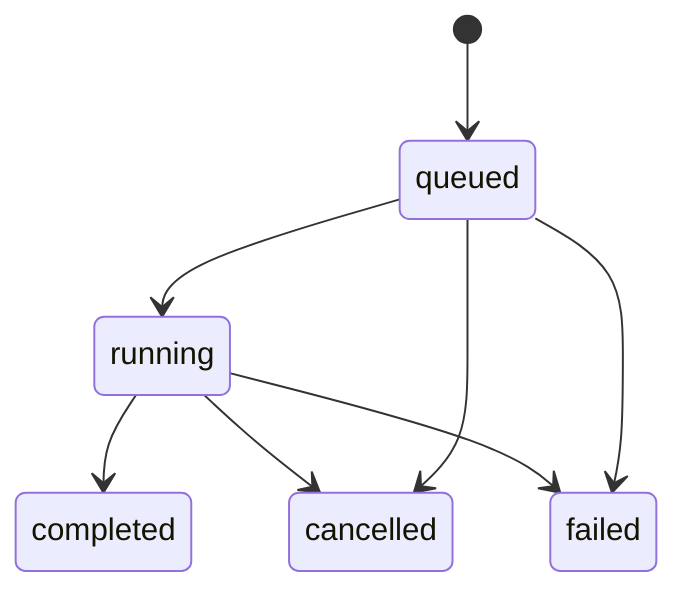

# Phase 3 詳細設計書: Viewer内Q&AとSource Code Viewer

- 文書バージョン: v1.0
- 更新日: 2026-11-16
- ステータス: 設計レビュー用。Phase 3の実装・実Codex検証は未実施
- 実装基準: Phase 2完了記録を含むmain `ae4102b`

本文書は、Viewerを読みながら追加質問し、回答の根拠を生成元Commitのソースで確認するための契約を定める。[概要仕様](./README.md)、[フロントエンド仕様](./frontend-spec.md)、[バックエンド仕様](./backend-spec.md)のPhase 3を具体化する。Phase 0 Chatは既存の一時Sessionのまま維持する。

## 1. 目的と範囲

対象は、Viewer右ペインのAsk Codex、Viewerの版ごとのConversationとMessage永続化、回答のSSE配信、中止・明示再試行、参照ファイルと行範囲、Source Code Viewerである。ブラウザ再読み込み後にも保存済み履歴と実行状態を取得できる。

ローカル・単一ユーザー・Public GitHub Repository・FastAPI単一worker・固定Codex CLIというPhase 2の前提を継承する。複数Conversationの任意作成、履歴編集・個別削除、添付、最新コードへの質問、コード変更、RAG、共有、リモート公開は対象外とする。Viewer旧版本文を表示する版管理UIも導入しない。旧版Q&Aの履歴と参照だけを閲覧できるようにする。

Phase 4に予定する永続SSEイベント、複数worker、監査基盤、大規模Repositoryの最適化は導入しない。ただし、履歴機能に必要なRESTでの状態復元、重複排除、bounded bufferからの再送不能通知はPhase 3に含める。

## 2. 現行実装からの設計判断

| 論点 | Phase 3の方針 | 理由・現行実装との関係 |
|---|---|---|
| 質問の対象 | Viewer ID、`content_revision`、`commit_sha`を固定 | RepositoryのHEADをそのまま使うとSync後の内容が混ざる |
| Conversation | Viewerの版ごとに1つ。現在版だけ送信可能 | 再生成後に旧本文の質問と新本文の質問を混在させない |
| 本文の保持 | 最初の質問受付時にViewerDocumentと生成条件をConversationへコピー | 現行Viewer行は再生成で上書きされる |
| Codex Thread | Q&Aの1 Turnごとに新しいephemeral Thread | DB履歴を正本にし、失敗Turnや以前のtool履歴を次の質問へ持ち越さない |
| 過去の会話 | 直近の完了済み質問・回答をpromptへ再投入 | App Server Threadの永続化・resumeには依存しない |
| 調査先 | 固定Commitから作るTurn専用テキストsnapshot | 管理Repositoryをcheckoutせず、旧Commitに対する探索を保証する |
| 回答形式 | `body`のplain textと構造化source参照 | 自由HTML・Markdown rendererを新設せず、安全に逐次表示する |
| Git保持 | Conversation固有refを追加 | 現行runnerは再生成成功後に旧Viewer revision refを削除する |
| ソース表示 | 保持refを照合して指定Commitのblobを返す | working tree、任意SHA、ホスト上の任意ファイルを公開しない |
| 並行処理 | 同じRepositoryのQ&A、Sync、Generation、削除は排他 | 初期版は既存のRepository排他へ統合する |

上位仕様の「Viewerごとに1つの既定Conversation」は「現在版に1つ」と具体化する。上位仕様にあった`Conversation.codex_thread_id`は設けず、実際の対応を`ViewerTurn.codex_thread_id`へ保存する。会話の継続性はDB上のConversationで保つ。

## 3. 利用の流れ

1. Viewerを開くと、現在版の履歴、旧版Conversation一覧、実行中Turnを取得する。取得だけではConversation行やCodex Threadを作らない。
2. 質問送信時に画面の`expected_viewer_revision`を送る。Backendは現在のViewer行と一致することを確認する。
3. 現在版のConversationがなければ、文書・生成条件・Commitをコピーし、保持refを作ってから、質問とTurnを受理する。
4. `202`で返ったTurn IDを使ってSSEとREST pollingを開始する。回答中も本文をスクロールできる。
5. Backendは指定Commitのsnapshotを作り、安全設定を検査し、Codexへ質問する。`body`だけを未確定テキストとして逐次配信する。
6. 終端成功、安全性、schema、source参照の検証後に回答を確定保存し、SSEで完了を知らせる。FrontendはRESTで正式なMessageを再取得する。
7. 参照を押すと、同じCommitのSource Code Viewerを開く。既存Viewer本文中の`data-source-reference-id`も同じ表示部品へ接続する。

再生成成功後は、現在版の入力欄を新しい履歴へ切り替える。旧版には「版N・Commit … の履歴（閲覧のみ）」を表示する。再生成失敗・中止、Theme/Density変更ではConversationを切り替えない。

## 4. データモデル

新規テーブルは`conversations`、`viewer_turns`、`messages`の3つ。UUID、UTCのtimezone付きtimestamp、JSON列のSQLAlchemy構成は既存とそろえる。PostgreSQLのserver_encodingはUTF8を必須とする。APIへ内部Thread ID、prompt、生JSON、snapshot絶対pathを返さない。

### 4.1 conversations

| 列 | 型・制約 | 用途 |
|---|---|---|
| `id` | UUID PK | アプリ採番 |
| `viewer_id` | UUID NOT NULL FK viewers RESTRICT | Viewer単位の削除で明示的に消す |
| `viewer_revision` | integer NOT NULL、1以上 | 質問対象の版 |
| `commit_sha` | varchar(64) NOT NULL | Viewerの確定値をコピー |
| `context_json` | JSON NOT NULL | title、request、additional_instruction、document_type、detail_level、target_audience、content_json |
| `context_hash` | varchar(64) NOT NULL | canonical JSONのSHA-256 |
| `next_turn_number` | integer NOT NULL、初期値1 | 受付順の採番 |
| `created_at`, `updated_at` | timestamp NOT NULL | 作成・履歴更新 |

`UNIQUE(viewer_id, viewer_revision)`を設ける。`context_json`と`commit_sha`は作成後に変更しない。Theme、Density、sanitized HTML、認証情報はコピーしない。旧版判定は現在のViewer revisionとの比較で行い、独立したarchived flagは持たない。

### 4.2 viewer_turns

| 列 | 型・制約 | 用途 |
|---|---|---|
| `id` | UUID PK | REST/SSEで使うTurn ID |
| `repository_id` | UUID NOT NULL FK repositories RESTRICT | Repository排他検索 |
| `conversation_id` | UUID NOT NULL FK conversations RESTRICT | 履歴の単位 |
| `turn_number` | integer NOT NULL、1以上 | Conversation内の受付順 |
| `status` | varchar(16) NOT NULL | queued / running / completed / failed / cancelled |
| `current_phase` | varchar(32) NOT NULL | 6章の処理段階 |
| `idempotency_key`, `request_hash` | varchar(128)、varchar(64) NOT NULL | 二重実行防止 |
| `retry_of_turn_id` | UUID nullable FK viewer_turns SET NULL | 再試行元 |
| `assistant_message_id` | UUID NOT NULL UNIQUE | 受付時に採番する確定回答の予定ID |
| `codex_thread_id`, `codex_turn_id` | varchar(255) nullable | 内部対応だけに使用 |
| `history_truncated_pairs` | integer NOT NULL、初期値0、0以上 | promptから省略した完了済み履歴の組数 |
| `cancel_requested_at` | timestamp nullable | 永続化した中止要求 |
| `error_code`, `error_message`, `error_retryable` | varchar(64)、varchar(500)、boolean nullable | 安全な失敗理由 |
| `created_at`, `updated_at` | timestamp NOT NULL | 受付・更新 |
| `started_at`, `completed_at` | timestamp nullable | 実行・終端 |

`UNIQUE(conversation_id, turn_number)`、`UNIQUE(conversation_id, idempotency_key)`を設ける。`repository_id`とConversationのViewerが属するRepositoryの一致を受付transactionで検証する。`status IN ('queued','running')`の行に対する`UNIQUE(repository_id)` partial indexを設ける。Generationとの横断排他はこのindexだけでは保証されないため、9章のRepository行lockも必須とする。

`(conversation_id, turn_number)`と`(status, updated_at)`のindexを設ける。statusとcurrent_phaseはCHECK制約、終端行は`completed_at IS NOT NULL`、非終端行は`completed_at IS NULL`とする。`completed`ではerror各列はnull、`failed`ではerror各列を必須とする。`cancelled`はerrorを持たない。

### 4.3 messages

| 列 | 型・制約 | 用途 |
|---|---|---|
| `id` | UUID PK | Message ID |
| `turn_id` | UUID NOT NULL FK viewer_turns RESTRICT | 質問と回答の組 |
| `role` | varchar(16) NOT NULL | user / assistant |
| `content` | text NOT NULL | 質問または確定した回答本文 |
| `answer_json` | JSON nullable | assistantだけが持つ検証済みQaAnswer |
| `created_at` | timestamp NOT NULL | 保存日時 |

`UNIQUE(turn_id, role)`を設ける。質問は受付時に1行、assistantは完了transactionで1行だけ作成する。failed/cancelledに確定assistant行を作らず、画面はTurnの状態から失敗・中止を表示する。未確定deltaはDBへ保存しない。MessageのstatusはTurnとの不整合を防ぐため別に持たない。取得順は`turn_number`、同じTurn内はuser→assistantとする。

### 4.4 Migrationと保持期間

既存migration head `20261025_0002`の次に3テーブルを追加する。Phase 0のメモリSessionを移行せず、既存ViewerのConversationを一括作成しない。fresh DBと既存Phase 2 DBでupgrade、FK、partial indexを実PostgreSQLでも確認する。SQLiteの成功だけをPostgreSQLの排他検証としない。

Q&A履歴とConversation refはViewer削除まで保持する。30日で消えるGeneration JobのcleanupをQ&Aへ適用しない。履歴上限で古いMessageを削除せず、一覧paginationとpromptの履歴上限で制御する。downgradeはQ&Aデータを失うため、通常起動から自動実行しない。

## 5. REST API

### 5.1 履歴取得

```http
GET /api/viewers/{viewer_id}/conversations
GET /api/viewers/{viewer_id}/messages?conversation_id={uuid}&before_turn_number={n}&limit=20
GET /api/viewer-turns/{turn_id}
```

Conversation一覧は`viewer_revision`降順のsummaryを返す。`limit=20`（1〜50）と排他的な`before_revision`で過去へ遡る。responseは`items / next_before_revision`、各項目は`id / viewer_revision / commit_sha / created_at / last_message_at / read_only`。任意のUUID指定では対象Viewerとの所属を検証する。

messagesで`conversation_id`省略時は現在版を選ぶ。未作成なら`conversation:null / turns:[]`を返す。`limit`はTurn組の件数で1〜50、既定20。最新のN組を古い順に返し、`next_before_turn_number`で過去へ遡る。cursorは排他的な正整数で、質問と回答を分割しない。responseには`viewer_revision / commit_sha / conversation / turns / active_turn / next_before_turn_number`を含める。`active_turn`はpagination範囲外でも返す。GETはDB状態から復元でき、Codex未接続・Q&A無効でも利用できる。

Turn DTOは`id / conversation_id / turn_number / status / current_phase / user_message / assistant_message / retry_of_turn_id / history_truncated_pairs / cancel_requested_at / created_at / started_at / completed_at / error`とする。`error`は`code / detail / retryable / trace_id`。未確定assistantは返さない。Q&A中の再読み込みでは「回答中・確定待ち」を表示し、途中テキストの完全復元は保証しない。

### 5.2 質問受付

```http
POST /api/viewers/{viewer_id}/messages
Idempotency-Key: <client-generated UUID>
Content-Type: application/json
```

```json
{
  "expected_viewer_revision": 2,
  "content": "この画面の削除処理では、どの順序でデータを消しますか？"
}
```

revisionは1以上。contentはtrim後1〜8,000文字、UTF8で32KiB以内とし、trim後の値を保存・hash化する。未知fieldは拒否する。質問に含まれるパスや指示で対象Commit・cwd・権限・tool設定を変更しない。

初回はConversationとuser Message、queued Turnを受理し、`202`でTurn DTOと`Location: /api/viewer-turns/{id}`を返す。入力のrevisionが現在版と異なれば`409 VIEWER_CHANGED`。作業中Repositoryや既存active処理とは`409 REPOSITORY_BUSY`。重複keyの同一requestは同じDTOを`200`で返し、taskを追加しない。

keyは1〜128文字、Conversation内で永続保持する。hash対象はoperation、Viewer ID、expected revision、正規化content、再試行元ID。最初に指定revisionの既存Conversationとkeyを検索する。再生成後でも既存key・同一hashなら元Turnを返し、別hashなら`409 IDEMPOTENCY_KEY_REUSED`。新規要求だけを現在版検査、flag、認証、接続、UTF8、baseline検査へ進める。事前検査失敗時はMessageやTurnを作らない。

応答喪失・network errorでは入力と同じkeyを保持し、利用者の再送で結果を照会する。新しい質問や意図的な再試行は新しいkeyを使う。FrontendはPOSTを自動再試行しない。

### 5.3 中止と再試行

```http
POST /api/viewer-turns/{turn_id}/cancel
POST /api/viewer-turns/{turn_id}/retry
Idempotency-Key: <new UUID for retry only>
```

cancelは空body、key不要。中止要求日時を先に保存し、queuedならモデルTurnを開始せずcancelled、runningならinterruptする。処理中は`202`、既に終端ならそのDTOを`200`で返す。終端を後から変更しない。

retryは空body。同じ質問・Conversationで新しいTurn組を作り`202`。対象はcancelled、または`failed && error_retryable=true`。同じkeyの再送は`200`。旧版Conversation、成功・非終端・非retryable Turnは`409 QA_RETRY_NOT_ALLOWED`。元の失敗記録を上書きしない。再試行もその時点の同Conversationの完了済み履歴を使い、古い失敗Turnのtool履歴は使わない。

## 6. Turnの状態と確定処理



phaseは`queued / preparing_snapshot / checking_safety / answering / validating_answer / saving_answer / done`。終端statusではphaseを`done`にそろえる。表示文言は「受付済み」「生成元コードを準備しています」「安全設定を確認しています」「回答を作成しています」「参照を検証しています」「回答を保存しています」。予定完了時刻は出さず、受付時から経過時間を表示し、30秒後に処理継続を案内する。

確定transactionではRepository→Viewer→Conversation→Turnの順にlockし、`status=running AND cancel_requested_at IS NULL`、現在版一致、安全検査の接続世代・epoch一致を確認する。assistant Message挿入とTurn completed更新を同じtransactionでcommitする。commit後だけ`turn.completed`を配信する。DB失敗・cancel競合・安全性失効時にassistantを部分保存しない。

利用者の中止要求が保存され、Codex終端`interrupted`を確認した場合だけcancelledにする。interruptの応答だけでは完了とみなさない。実行終了を確認できない場合はPhase 2と同じ共用接続の破棄で停止を保証し、他Turnも接続失敗として終了させる。未確認の処理が残ったままsnapshotを消したり、排他を解除したりしない。安全性違反は中止要求があってもfailedを優先する。

起動時は受付を開く前にqueued/runningを`failed / QA_INTERRUPTED / retryable:true`へ回復し、旧Threadへresumeしない。DBに中止要求があった場合も、実終端を観測していなければ失敗として記録する。前回子プロセスの停止を確認してから残留snapshotを回収する。質問と過去の確定回答は残す。正常shutdownでも実行停止と安全なterminal保存を試み、残りは次回回復対象とする。

## 7. 回答schemaとストリーミング

### 7.1 QaAnswer v1

```json
{
  "schema_version": "1.0",
  "body": "削除は、ローカルの管理Workspaceを消した後に登録行を消す順序です。",
  "source_references": [
    {
      "id": "src-1",
      "path": "backend/app/repositories/service.py",
      "start_line": 236,
      "end_line": 288,
      "description": "Repository削除の順序"
    }
  ],
  "limitations": []
}
```

例のpathと行は構造説明用であり、実装時にその時点の対象Commitで検証する。schemaは全field必須、`additionalProperties:false`、strict Pydanticで検証する。bodyは1〜16,000文字、limitationsは最大10件・各500文字、参照は最大20件。ID規則とpath長500文字は既存SourceReferenceを再利用し、IDとpath/行範囲の重複を拒否する。参照1件の範囲は最大500行とする。

Repositoryの実装について回答する場合は最低1参照を要求する。根拠がない旨の回答は参照0件を許可し、空でないlimitationsを必須とする。schemaはこの組合せも検証する。機械検証は参照の存在・行範囲を保証し、説明の正しさ全体を保証するものではない。

参照のCommitはモデルに選ばせず、ConversationのCommitをBackendが付与する。body内のパス文字列やMarkdownリンクを操作可能な参照に変換しない。bodyはReactのtext nodeと`white-space: pre-wrap`で表示し、HTMLとして扱わない。参照とlimitationsは別部品で表示する。

### 7.2 JSONの途中出力

`turn/start`には毎回QaAnswerの`outputSchema`を渡す。raw JSON deltaをSSEへ転送しない。許可したagentMessage Item単位でbufferを分離し、root objectの`body`文字列だけをincremental JSON decoderで取り出す。key順を前提にせず、escape、引用符、分割Unicode escape、surrogate pair、UTF8境界に対応する。正規表現による切出し、JSON全体の表示、他fieldへのfallbackは禁止する。

暫定本文には「回答中・参照未検証」を表示する。raw bufferは128KiBまでとし、bodyの上限超過、重複key、不正escape、未知構造、曖昧な複数の回答Itemは失敗にする。最終JSONはduplicate key拒否のparserでも検証する。deltaで復元したbodyと確定bodyの一致を確認し、不一致なら保存しない。

commentary・reasoning・command出力は回答deltaに混ぜない。Itemのphaseが`final_answer`と確認できた場合だけ、そのItemのbodyを逐次配信する。phase未確定の間はbufferにとどめる。phaseが最後までnullの場合は、終端時にschemaを満たす候補が1つだけであることを確認して確定表示する。複数候補は曖昧として失敗にする。`partial_answer`をfinal answerとみなさない。識別不能を理由に生出力を公開しない。通常成功系でbodyが逐次配信できることをPhase 3完了条件とする。

schema修正Turnの自動送信は行わない。途中で見せた本文を別出力で差し替える複雑さを避け、形式不正は`QA_ANSWER_INVALID`として明示再試行する。失敗・中止・安全性違反では暫定bodyを画面から除き、確定回答と誤認させない。

### 7.3 SSE

```http
GET /api/viewer-turns/{turn_id}/events?after={sequence}
Last-Event-ID: <sequence>
```

| event | payloadの追加field | UI処理 |
|---|---|---|
| `turn.started` | status | 実行開始 |
| `turn.phase.changed` | phase | 進捗更新 |
| `message.delta` | assistant_message_id、delta | 暫定bodyへ追記 |
| `turn.completed` | assistant_message_id | REST再取得、暫定本文を置換 |
| `turn.failed` | error | 暫定本文を破棄、エラー表示 |
| `turn.cancelled` | なし | 暫定本文を破棄、中止表示 |
| `stream.reset` | reason | deltaを破棄、REST再取得 |

通常eventに`turn_id / sequence / occurred_at`を含める。assistant UUIDは受付時にアプリで決定し、完了時に同じIDのMessageを保存する。`viewer_turns.assistant_message_id`は完了前にはMessageがないためmessagesへのFKを設定しない。ModelのItem IDは公開しない。

既存EventBufferを拡張し、Turnごとに最大500 event、heartbeat20秒を既定とする。eventはメモリのみで、終端後10分でbufferを解放する。`after`は新しいEventSourceを作り直す場合のcursorで、同一接続の自動再接続ではLast-Event-IDを使う。両方あれば有効なLast-Event-IDを優先する。非負整数以外は422。画面は`sequence <= lastSequence`を無視する。

cursorがbufferの最古より前、末尾より後、またはbufferがなければ`stream.reset`を送り接続を閉じる。resetは通常sequenceを進めず`id:`を付けない制御eventとする。新規接続でafter省略の場合は0を使用し、既に先頭を失っていればresetする。terminal DB状態の場合はREST取得を促して閉じる。reset後はそのTurnのdelta購読を止め、5秒REST pollingで確定を待つ。無限再接続・途中deltaだけの継ぎ足しをしない。

queued/runningの間はSSE接続中も5秒REST pollingを行い、完了通知の消失を補う。SSE切断やRoute移動ではTurnを中止しない。ページを離れたときは購読を閉じてよく、戻ったときに履歴とactive TurnをRESTで取り直す。多重タブでも同じDB状態を表示する。

## 8. 固定Commitの調査とCodex連携

### 8.1 テキストsnapshot

配置は`WORKSPACE_ROOT/qa-snapshots/<turn-uuid>/`。サーバーがUUIDから導出し、ユーザーpathをrootへ連結しない。Gitの管理Repositoryは既存resolverで解決する。

1. Repository排他内でConversation refとDBのCommit一致を確認する。full SHAは既存Git形式に合わせ40桁の小文字hexに限定し、短縮SHA、ref式、任意revision演算子は受け付けない。
2. 隔離したGit環境で`ls-tree -r -z <sha>`を読み、tree entryのpath・mode・object IDを検証する。tree出力・timeoutにも上限を適用する。
3. 通常blob（`100644`と`100755`）だけをobject IDで読み出す。symlink、submodule、binary、非UTF8、2MiB超のblob、LFS pointerはsnapshotに含めず、除外理由をmanifestへ記録する。manifestはpromptのlimitationsにも渡す。除外対象を根拠とする参照は不合格とする。
4. path traversal、制御文字、backslash、`.git`segment、case/Unicode正規化で同じ保存先になるpathを拒否する。macOSのfilesystemで上書き衝突を起こさない。unsafe pathは黙って書き換えず`QA_SNAPSHOT_UNSUPPORTED`で停止する。
5. UTF8テキストを元のbyte列のまま、新規の通常fileとして配置する。実行bitは付けない。LFS、smudge、checkout、submodule、Repository内scriptを実行しない。`.git`やshared object storeへのsymlinkを持たせない。
6. fileごとのhash、件数、総量を検証してsnapshotを完成させる。manifestはアプリのメモリに保持し、Repositoryの同名fileを上書きしない。作成途中ではThreadを始めない。

snapshot上限はテキスト総量128MiB、20,000 file、準備60秒を既定とする。上限超過では部分snapshotで回答せず失敗する。Gitプロセスは出力をchunkで制限し、サイズは読出し前の`cat-file -s`でも検査する。サイズ確認後も読出し上限を維持する。これはBackendでの処理であり、CodexにGit/CLTの実行を要求しない。

`.codex`等の設定fileを無条件に信用しない。snapshotのcwdでPhase 2のconfig/requirements、layer、instructionSources、feature、MCPを再検査し、プロジェクト設定の影響を無効化・確認できなければTurnを開始しない。検査を通すために設定を改変・削除して黙って続行しない。Repositoryの`AGENTS.md`やコメントは調査データとしてのみ扱う。

### 8.2 Threadとprompt

Auth/Chat/Generationと同じstdio App Serverを使い、固定CLI `0.164.0`と既存起動policyを維持する。`GenerationPreflight`の検査本体を共通化し、Q&A Turn UUID・snapshot cwdで呼べるようにする。起動policyを緩めず、Q&A用途のdeveloper instructionsだけをアプリ定数で追加する。

`thread/start`は`ephemeral:true / approvalPolicy:never`、Turn固有Permission Profileでsnapshot rootだけをread可とし、networkを無効にする。管理Repository、他snapshot、DB、ユーザーhome、一時領域外のsentinelを読めないことを検査する。`:minimal`等の必要な実行環境はPhase 2と同じ条件で扱う。config/requirements、Thread応答、runtime全page、接続世代・security epochの検査を毎Turnと保存前に行う。

promptへ渡す情報は、対象Viewer ID・版・Commit、Conversationのcontext_json、直近の完了済み質問・回答最大10組、今回の質問、除外manifestの要約、QaAnswer schemaとする。過去履歴は最新から完全な組で選び、履歴のUTF8合計64KiB以内に収めてから受付順へ戻す。failed/cancelledの質問、暫定回答、過去command/tool出力は含めない。省略した履歴の組数をUIのTurn DTOへ`history_truncated_pairs`として返す。

contextと今回の質問は途中で切らない。prompt全体がUTF8で1.25MiBを超える場合は`QA_CONTEXT_TOO_LARGE`として失敗し、勝手な要約や一部文書だけへの置換をしない。参照のpath・行番号はsnapshotの元ファイルに対応させる。根拠不足とsnapshot除外を回答のlimitationsへ記載させ、最新Commitの調査やコード変更を求められたら対象範囲を説明する。

Thread/Turn IDと接続世代で通知を振り分け、通知がRPC応答より早い場合もItemを対応づけておく。未知tool Item、承認要求、設定失効はPhase 2と同じ拒否・停止・非保存とする。shared connectionを破棄したときはGeneration/Phase 0の実行状態も失敗へ伝播させる。

正常・異常終了ともThreadの停止確認後にunsubscribeし、snapshotを削除する。読み取ったfileのhash不変と管理RepositoryのHEAD/status不変を検証記録に残す。cleanup失敗は安全な分類とtrace IDを記録し、起動時回収対象にする。snapshotを永続履歴として使用しない。

## 9. 排他・Git ref・削除

### 9.1 Repository単位の排他

新規Q&A受付、Generation受付、Sync、Repository削除、Viewer再生成・削除の全経路で、同じRepository行を`SELECT ... FOR UPDATE`してから、Repository状態、active Generation Job、active ViewerTurnを再確認する。DBのlock順はRepository→Viewer→Conversation→Turnへ統一する。in-processでは既存`RepositoryOperationRunner`の同じRepository lockを使い、別のQ&A専用lockだけで済ませない。

queued行をcommitした時点から終端・cleanup完了までRepositoryを予約する。task開始前の窓ではactive行、終端保存後のcleanup中は共通process lockによって他操作を拒否する。受付はそのlockも検査し、cleanup中に次の行を受理しない。短い受付DB transactionの間に外部RPCや長時間のsnapshot作成を待たない。runnerは既存Generationと同じくプロセス内taskで動かす。schedule失敗時はTurnをfailedへ確定し、予約を解放する。

同じRepositoryの別Viewerからの質問も同時実行しない。他Repositoryは並行可能だが、GenerationとQ&Aで共通semaphoreを使い、既存`generation_max_concurrency`（既定2）を超えない。枠待ちもqueuedとして予約し、待機中の中止を可能にする。共通設定名は互換性のため維持し、将来改名を別変更とする。

Source APIのblob取得も短時間のRepository lock内で行い、削除・ref更新と競合させない。Q&A/Generation実行中のsource要求は待機を積み上げず`409 REPOSITORY_BUSY`を返し、参照UIに明示再試行を出す。Viewer本文と保存履歴のGETは排他せず利用できる。Theme/Density変更もQ&Aのcontextに影響しないため許可する。

### 9.2 Conversation ref

```text
refs/repospec/conversations/<conversation-uuid>
```

最初の質問受付で、Repository lock内で現在Viewer ref→DB SHAの一致を確認し、Conversation UUIDを決定する。Conversation refをcreate-onlyで作り、その後のDB transactionでcontext、質問、Turnを保存する。DB失敗時にrefを回収し、crash時は起動時reconcileで孤立refを消す。ref作成前にConversationをcommitしない。

再生成成功後もConversation refを削除しない。旧Viewer revision refは従来どおり削除できる。reconcileの期待ref集合を「現在Viewer revision ref＋全Conversation ref」に拡張し、既存`GenerationService.reconcile_refs()`がConversation refを孤立と誤認しないよう同時に変更する。参照先の誤ったrefは自動で別Commitへ付け替えず、Q&A/Sourceを停止して不整合を知らせる。

### 9.3 Viewer削除

active Q&Aまたは対象Viewerの再生成中は`409 VIEWER_BUSY`で拒否する。同じRepositoryの別処理がlockを保持する場合もbusyにする。確認ダイアログには「Viewerと、このViewerの全版の質問履歴を削除」を明記する。

削除はRepository lock内で、該当Viewer revision refとConversation refを削除し、その後1 transactionでmessages→viewer_turns→conversations→Viewerの順に削除する。retry FKはSET NULL、Generation Jobのviewer_idは既存どおりSET NULLにする。Git側失敗時はDB履歴を残して再試行できるようにする。

ref削除後のDB失敗ではDBから算出したrefを再作成して復旧を試み、失敗時もエラーを成功にしない。起動時はDBで必要な欠落refを、Commitがローカルに残る場合だけcreate-onlyで復元してから孤立refを回収する。Commit自体がなければ`SOURCE_COMMIT_UNAVAILABLE`とし、再取得や最新Commitへの置換で隠さない。GCは削除・復旧transactionの外側で自動実行しない。

Repository削除の関連データ検査へConversation/ViewerTurnを加える。Viewerが残る場合は従来どおり削除不可。全Viewer削除後に関連Q&Aが残っていれば不整合として拒否し、暗黙のcascadeで隠さない。

## 10. Source Code API

```http
GET /api/repositories/{repository_id}/source?viewer_id={uuid}&commit={sha}&path={relative_path}&start={n}&end={n}
GET /api/repositories/{repository_id}/source?conversation_id={uuid}&commit={sha}&path={relative_path}&start={n}&end={n}
```

`viewer_id`と`conversation_id`はちょうど一方を必須にする。Viewer本文は前者、確定Q&Aの参照は後者を使う。IDの所属Repository、DB SHA、保持refの解決先、要求SHAの全一致を検査する。Viewerの場合は現在版だけ、旧版の参照はConversation経由でのみ取得する。保持対象でない任意SHAはobjectが存在しても返さない。pathはそのCommitに属する通常テキストfileを指定でき、Repository全体をホストpathへ変換しない。

検証順はcontext所属→SHA形式/一致→ref→path→tree entry→blobサイズ/type/encoding→行範囲。pathはURL queryで一度decodeされた値を検証し、再帰的unquoteをしない。絶対path、空segment、`.`、`..`、backslash、NUL、制御文字、`.git`segmentを拒否する。path lengthは500文字、start/endは必須、1以上、`start <= end`、要求範囲500行以内とする。blob行数外は補正せず422。

Git treeから完全一致のentryを探し、`100644/100755`のblobだけをobject IDで読む。symlinkとgitlinkは追跡・dereferenceしない。binary、非UTF8、LFS pointerは422、file全体2MiB超やresponse JSON全体256KiB超は413。`cat-file -s`とbounded readを使い、Git取得のtimeoutを10秒とする。credentials、hooks、外部config、replace objects、ambient `GIT_*`を隔離する共通Git helperを使う。shell文字列、`--textconv`、`--filters`、working treeのfile openを使わない。

行分割はLFを境界とし、CRLFでは表示用に末尾CRを除く。最終LFによる余分な空行は数えず、空blobは0行とする。既存`SourceReferenceValidator`の`splitlines()`も同じ規則へ統一し、Unicode改行文字やCRだけでGitHubと行数がずれないようにする。既存Viewerの参照は取得時にも再検証し、不一致なら行を黙ってずらさずエラーにする。通常fileのmodeは共有validatorも`100755`へ拡張する。

```json
{
  "repository_id": "11111111-1111-4111-8111-111111111111",
  "commit_sha": "846f7c90000000000000000000000000000000000",
  "path": "backend/app/repositories/service.py",
  "start_line": 236,
  "end_line": 238,
  "total_lines": 398,
  "lines": [
    {"number": 236, "text": "    async def delete(self, repository_id, trace_id):"},
    {"number": 237, "text": "        ..."},
    {"number": 238, "text": "        ..."}
  ],
  "language": "python",
  "github_url": "https://github.com/example/repository/blob/846f7c90000000000000000000000000000000000/backend/app/repositories/service.py#L236-L238"
}
```

response例のSHA・内容は説明用である。languageはサーバーの拡張子allowlistから返し、未知はtext。GitHub URLは登録済みcanonical URL＋full SHA＋segmentごとにencodeしたpath＋固定行anchorからBackendが組み立てる。モデル由来のURLを採用しない。全responseに`Cache-Control:no-store`、`X-Content-Type-Options:nosniff`を付け、ソースはJSONでのみ返す。

## 11. Frontend

### 11.1 画面と状態

Routeは`/viewers/:viewerId`を維持する。Desktop幅1,280px以上は目次・本文・幅360pxのQ&A paneとし、paneは折りたたみ可能にする。768〜1,279pxは目次を折りたたみ、Q&AはDrawer、768px未満は「文書 / 質問」のタブに切り替える。本文containerの既存CSS Container Queryとrenderer HTMLを維持する。

Q&AのHeaderに版とCommitを常時表示し、Repository.latest_commit_shaと違う場合は「この質問はViewer生成時のCommitが対象です」と案内する。これは質問対象の説明であり、Phase 4のRepository全体の古さ通知は別途扱う。旧版履歴selectorは文書本文を切り替えず、「本文は現在版、質問履歴は版N」と明示し、旧版では入力を無効にする。

入力はPhase 0のIME判定（composition ref、isComposing、keyCode229）とEnter/Shift+Enter規則を共用する。accepted後にだけ入力をクリアする。受付失敗・応答喪失ではdraftとkeyを保持する。draftはcomponentメモリのみとし、ブラウザ再読み込みをまたいだ保存は行わない。送信中とactive Turn中は二重送信を禁止し、中止中は中止ボタンを無効化する。

履歴・未作成・取得失敗・無効・認証切れ・送信中・queued・回答中・再接続・検証中・完了・中止・失敗を区別する。Q&A flag falseでも履歴と参照を閲覧できる。初期履歴GETの失敗時は本文を表示し続け、履歴の再試行を提示する。現在版が外部タブで再生成されていたら409で入力を保持し、ViewerとConversationを再取得する。

### 11.2 Source Code Viewer

既存source popoverをSourceCodeDialogへ置き換える。タイトルにpath、版・full Commit、参照説明、行範囲を表示する。初回は参照範囲に前後20行を加え、500行以内で取得する。Q&A参照が500行なら追加contextを付けない。既存Viewerの500行超の参照は最初の500行と分割案内を表示し、前後の取得を500行単位で行う。範囲の末尾はtotal_linesへ合わせ、選択自体は変更しない。

Source APIはEOFを超える要求を拒否するため、初回はまず参照の有効な範囲（最大500行）を取得してtotal_linesを得る。その後、必要な場合だけ前後contextをclampして再取得する。無効参照や欠落fileの取得で別path/最新Commitへfallbackしない。クリック連打では前要求をAbortControllerで中止し、選択contextと一致する応答だけを反映する。

行番号、参照範囲の背景、最初の参照行へのscroll、GitHubリンクを表示する。Source本文はReactのtext nodeで描画する。Shikiを遅延loadし、アプリ同梱のlanguage/themeだけを使い、tokenをReact要素へ変換する。生成HTMLを`dangerouslySetInnerHTML`へ渡さない。言語未対応・highlight失敗時もplain textと行番号で閲覧できる。外部CDN・任意grammar・任意themeは読み込まない。

DialogはEscapeで閉じ、focus trap、初期focus、起動元へfocus復帰、読み込み・エラーの読み上げを実装する。codeの横scrollはDialog内だけとし、Mobileで画面全体を横に広げない。本文のsource操作もclickだけでなくbuttonのEnter/Spaceで開けることを確認する。

### 11.3 データの配置

Query keyは`['viewers', viewerId]`、`['viewerConversations', viewerId]`、`['viewerMessages', viewerId, conversationId ?? 'current']`、`['viewerTurns', turnId]`、`['repositorySource', repositoryId, contextKind, contextId, commit, path, start, end]`。永続履歴とTurn状態はTanStack Query、draft・未確定delta・SSE cursor・Dialog選択は専用hookのメモリへ置く。queryの取得順が逆転しても別版のcacheを混ぜない。

SSE完了と5秒pollingのどちらで終端を知っても同じ確定処理を1回行い、該当履歴を再取得する。再生成成功後は現在版Queryを無効化し、新旧Conversationを再取得する。Viewer削除時はそのViewerの履歴・Turn・Source cacheと購読を破棄する。ログアウト時も購読とメモリcacheを消すが、Backendの実行を自動中止しない。ストリーミングのaria-liveは短い状態通知を中心にし、全文の再読み上げを繰り返さない。

## 12. エラー契約と設定

既存Problem Detailsの`code / detail / retryable / trace_id`を使う。非同期errorのtrace IDはアプリTurn UUID。参照失敗でもViewerや履歴を消さない。

| HTTP / code | 用途 | 利用者の操作 |
|---|---|---|
| 401 AUTH_REQUIRED | 新しい質問の認証が必要 | 入力保持、ログイン |
| 404 VIEWER_NOT_FOUND / CONVERSATION_NOT_FOUND / VIEWER_TURN_NOT_FOUND | 未存在・別Viewerのcontext | 対象を再確認 |
| 404 SOURCE_NOT_FOUND | 指定Commitにfileなし | 別参照を選ぶ |
| 409 VIEWER_CHANGED / REPOSITORY_BUSY / VIEWER_BUSY | 版・処理競合 | 再取得、処理完了後に明示再試行 |
| 409 IDEMPOTENCY_KEY_REUSED / QA_RETRY_NOT_ALLOWED | 不適切な再送 | 自動再送しない |
| 409 SOURCE_COMMIT_UNAVAILABLE | 保持ref欠落・不一致・Commit欠落 | trace IDを表示。最新コードへ置換しない |
| 413 SOURCE_TOO_LARGE | blob・response上限 | 範囲を狭める。blob上限超は範囲変更でも取得不可 |
| 422 SOURCE_PATH_INVALID / SOURCE_RANGE_INVALID / SOURCE_UNSUPPORTED | path・行・mode・encoding不正 | 入力または参照を確認 |
| 503 QA_DISABLED | QA_ENABLED=false | 履歴閲覧は継続 |
| 503 CODEX_UNAVAILABLE | 未接続 | 明示再試行 |
| 503 CODEX_SANDBOX_UNSUPPORTED | 安全設定が不合格・判定不能 | 自動再試行しない |
| 503 DATABASE_ENCODING_UNSUPPORTED | 非UTF8 DB | UTF8 DB準備手順へ誘導 |
| 504 SOURCE_TIMEOUT | Git blob取得timeout | 明示再試行 |

受付後の失敗は`QA_INTERRUPTED / CODEX_UNAVAILABLE / CODEX_TIMEOUT / CODEX_TURN_FAILED / QA_ANSWER_INVALID / SOURCE_REFERENCE_INVALID / QA_FAILED`をretryable true、`CODEX_SANDBOX_UNSUPPORTED / QA_SNAPSHOT_UNSUPPORTED / QA_CONTEXT_TOO_LARGE / DATABASE_ENCODING_UNSUPPORTED`をfalseとする。snapshot容量超過は`QA_SNAPSHOT_TOO_LARGE / retryable:false`とする。利用上限が識別できる通知は既存error mappingとそろえ、一般接続失敗に潰さない。

| 設定 | 既定値 | 用途 |
|---|---|---|
| QA_ENABLED | false | 新規質問・再試行だけを制御。履歴/Sourceは独立 |
| QA_TIMEOUT_SECONDS | 300 | snapshot準備・枠待ちを除くQ&A処理全体 |
| QA_SNAPSHOT_TIMEOUT_SECONDS | 60 | snapshot準備 |
| QA_SNAPSHOT_MAX_BYTES | 134217728 | 配置するテキスト総量 |
| QA_SNAPSHOT_MAX_FILES | 20000 | 配置file数 |
| QA_EVENT_BUFFER_SIZE | 500 | Turnあたりevent数 |
| SOURCE_TIMEOUT_SECONDS | 10 | Source Git処理 |
| SOURCE_MAX_LINES | 500 | 1応答の行数 |
| SOURCE_MAX_RESPONSE_BYTES | 262144 | JSON応答量 |

blob上限は既存`viewer_source_max_file_bytes`（2MiB）を共用する。正値を検証し、回答・prompt・Sourceのhard limitはコード定数で引き上げ不可とする。`GENERATION_ENABLED`をQ&Aの有効判定に流用しない。`.env`、通常DB、既存Viewer、CLI、認証設定は今回の設計作業では変更しない。

## 13. 実装の配置と分割

| 順序 | 主な対象 | 完了する契約 |
|---|---|---|
| P3-01 永続化と受付 | `backend/app/conversations/{models,store,service}.py`、API schemas/routes、Alembic | revision別context、Message/Turn、pagination、idempotency、cancel/retry、起動回復。QAは無効のまま |
| P3-02 Commit保持とSource | `backend/app/sources/{service,snapshot}.py`、既存Git helper/source validator/ref/reconcile、Repository/Generation service | Conversation ref、削除/復旧、全受付経路の横断排他、bounded blob、固定Commit snapshot |
| P3-03 CodexとSSE | `backend/app/conversations/{runner,answer,prompt}.py`、共通preflight、EventBuffer | QaAnswer、decoder、安全な通知分類、停止確認、保存CAS、共通concurrency |
| P3-04 UI | `frontend/src/features/conversations/`、`features/sources/`、ViewerPage、styles、API types | Ask pane、履歴、IME、SSE/REST復帰、Source Dialogとhighlight |
| P3-05 受入 | Fake/実PostgreSQL/実CLI fixture、手動ガイド、verification | 15章の条件と証拠種別を記録 |

各実装は最新mainから別の`codex/`ブランチとPRで進める。P3-01の受付は後続処理がつながるまでQA_DISABLEDで拒否し、偽の成功や動かないqueued行を公開しない。P3-02のref/reconcile/削除/排他の変更は一体で取り込む。既存Phase 0 Chatの設計を書き換えず、共通部品変更だけ回帰確認する。

## 14. テスト設計

| 分類 | 必須の確認 |
|---|---|
| DB/API | 初回質問でcontextコピー、同revisionで再利用、再生成成功だけ新履歴、旧版は閲覧のみ、paginationで組を分割しない、別ViewerのConversation拒否 |
| 二重実行 | 同key同bodyは同じTurn、別bodyは409、再生成後の応答喪失再送も元Turn、複数タブで新規質問とretryが競合してもactiveは1つ |
| 状態 | queued中止、running interrupt、保存との競合、予期しないinterrupted、拒否後completed、DB保存失敗、schedule失敗、起動回復、回答は完了時だけ1行 |
| Commit | Aで生成→BへSync→質問の調査結果/参照はA、再生成後もAのQ&A参照を開ける、同Commit別revisionを分離、Git GC後も保持refでAを取得 |
| 排他 | Sync/Generation/削除/Q&Aの全受付組合せを実PostgreSQLの複数connectionで競合させる。異なるRepositoryは共通枠内で進む |
| ref/削除 | ref作成後DB失敗、reconcileでConversation ref保持、ref欠落の復元、誤ったref停止、Git削除失敗、DB削除失敗、Viewer削除後に全Q&A消滅 |
| snapshot | 元byte/hash一致、100755の非実行化、symlink/gitlink/LFS除外、path escape/case/Unicode衝突停止、巨大tree/blob・timeout停止、finally cleanupと起動時残留回収 |
| Source | 任意SHA/別Repository/短縮SHA/相対脱出/percent二重decode拒否、UTF8日本語、CRLF/LF/最終LF/空blob/Unicode改行、500行・2MiB・256KiB境界、binary/非UTF8拒否 |
| 出力 | JSONを1文字ずつ分割、escape/日本語/surrogate/key順/重複key/複数Item、source参照不正、schema上限、本文とrefsの分離、HTML/scriptをtext表示 |
| SSE | 応答前通知、重複/他Turn/古い接続世代、buffer欠落/reset、cursor前後不正、再接続、terminal event消失、reload/Route往復、REST完了とSSE完了の競合 |
| UI | 日本語IME、入力保持/再送key保持、queued/無効/旧版/失敗、Source連打応答逆転、キーボード/Dialog focus、未知言語fallback、Mobileの横幅 |
| 回帰 | Phase 0認証/Chat/中止、Phase 1 Clone/Sync/削除、Phase 2生成/再生成/Theme/Density/中止/Viewer削除、既存sanitizerとrenderer |

自動テストはFake App Server＋使い捨てDB/Git fixtureを基本とし、実認証・外部可用性へ依存させない。lint、型検査、production build、migration確認を実施する。画面確認は390px、768px、1,024px、1,440pxで、本文containerの折り返し、Q&A切替、Source内部scrollを確認する。

実Codex試験は別の明示実行harnessで、固定CLI/schema/policy/OSを記録する。Phase 2の全必須9gateを回帰し、さらにsnapshot cwdだけ読めること、管理Repository・隣接snapshot・home・一時領域外sentinel拒否、snapshot非変更、command network拒否、Thread/runtime検査、QaAnswerの実構造化出力と逐次本文を確認する。外側sandboxや閉じたportによる誤合格を避け、非機密fixtureと対照試験を使う。

結果はgate別に`passed / failed / not_run / inconclusive`、証拠種別を実CLI・実Turn・Fake・合成UIに分ける。実RPC承認要求が発生しなければ`not_observed`を明記する。実ユーザーのconfig・認証情報・生promptを記録せず、件数・status・hash・安全な分類を残す。通常DBの既存Viewerを試験用に削除・上書きしない。

## 15. 実装の完了条件

以下はすべて未達であり、設計書やFake試験の作成だけでPhase 3完了としない。

1. 現在版への質問、回答の逐次表示、確定回答と参照の永続保存が通常UIから動く。
2. reload・Route往復・SSE再接続で実行状態を取り直せ、質問の二重実行やdelta重複が起きない。
3. 中止・失敗・明示再試行・起動回復の状態がDBとUIで一致し、未確定回答を正式履歴に残さない。
4. Sync後のQ&AがViewerの元Commitを調査し、最新working treeの内容を混ぜない。
5. 再生成成功後の新規質問は新revisionに属し、旧版の履歴とsource参照も保持する。
6. Viewer本文とQ&A双方の参照から、正しいCommit・path・行のSource Code Viewerを開ける。
7. path/Commit/blob/上限/XSS対策、Repository横断排他、refと削除・復旧が14章の試験を満たす。
8. 非機密の実CLI検証で必要な安全gateに合格し、実QaAnswerのストリーミング・保存・参照取得を確認する。
9. 実装・自動試験・安全gate合格後に利用者がQA_ENABLEDを有効化し、通常UIで質問・中止・再試行・再生成後履歴を確認する。
10. Backend/Frontend回帰、実PostgreSQL migration/競合、lint/build、レスポンシブとキーボード確認が成功し、証拠と残る制約を記録する。

## 16. 実装開始時に確認する点

CLIやpolicyの更新は今回の前提に含めない。2026-11-16に固定実行ファイルの`--version`と`app-server generate-json-schema --experimental`を一時領域で実行し、`codex-cli 0.164.0`を確認した。モデルTurn、通常アプリの設定変更は行っていない。PATH alias作成のsandbox警告は出たが、schema生成はexit 0で完了した。

| schema | 確認した契約 | SHA-256 |
|---|---|---|
| ItemStartedNotification | agentMessageにid/text/typeが必須、phaseはnullable | `c5dc7bc43ffd6164b0920004e15b97f0d2b91f44e21547615122dbd6b104faf1` |
| ItemCompletedNotification | 同じItemでtextとphaseを取得可能 | `2b80261a0bdb2c6fa2ffd97584ae3fb7979f2105614b395ef66375bc10b4e69b` |
| AgentMessageDeltaNotification | threadId/turnId/itemId/deltaが必須、phaseは含まれない | `996e6c0ea65e57bed5a00f410b94381fe5ebf804333e5d00c2b6e6d47e5c55f6` |

MessagePhaseのenumはcommentary/partial_answer/final_answerであり、providerが一貫して出力する保証はない旨がschemaに記載されている。このため7.2のnull時fallbackを設ける。schemaでfieldが存在する確認と、実Turnでstreamingを観測する確認は分ける。実装時にはFake fixtureでItem開始前delta、phase更新、Item完了textとdeltaの一致、終端との対応を検証する。`outputSchema`の存在だけで途中JSONの安全な本文抽出を保証したとみなさない。

snapshotではGit/CLTを使わずrg等で調査できるが、snapshot cwdでのPermission Profileとtool実行は新しい経路である。Phase 2の成功をそのままQ&Aの合格へ流用しない。snapshotを読むための広いroot許可や、最新working treeを使うfallbackは追加しない。

Shikiの導入version、language subset、Vite/CSPとの組合せはP3-04でlockfileとproduction buildにより固定する。本文の正しさ、Snapshotから除外したfileへの質問、履歴上限による文脈不足は回答のlimitationsとUIで伝え、無制限の探索や自動要約を追加しない。

## 17. 参照資料

- [Phase 2詳細設計](./phase-2-detailed-design.md)の14章（Codex安全設定）、15章（source/ref）、17章（排他）、23章（引き継ぎ）
- [Phase 2最終受入記録](./verification/2026-11-09-phase-2-acceptance.md)。旧Commit参照のBackend検証成功と、モデル側Git/CLT制約を区別する
- [OpenAI公式: Codex App Server](https://learn.chatgpt.com/docs/app-server)（2026-11-16参照）。Thread/Turn、ephemeral、outputSchema、agentMessage Itemを確認。本文の版分離・snapshot・DB履歴は本アプリ固有の設計である
- [Git公式: git-cat-file](https://git-scm.com/docs/git-cat-file)（2026-11-16参照）。object type/size/blob取得を使用し、filterやtextconvを使わない
- [Shiki公式: Installation & Usage](https://shiki.style/guide/install.html)（2026-11-16参照）。Source表示のhighlightに使用し、tokenからのReact描画は本アプリ側で実装する
